<p align="center"></p>

<h1 align="center">ZORIX</h1>

<p align="center"><strong>A harness for AI.</strong> Run activities with explicit permissions, human approval, limits,<br/>
checkpoints and a complete record, whichever model does the thinking.</p>

<p align="center">
  <a href="https://github.com/LuisPeixoto/zorix/actions/workflows/ci.yml"></a>
  <a href="LICENSE"></a>
  
</p>

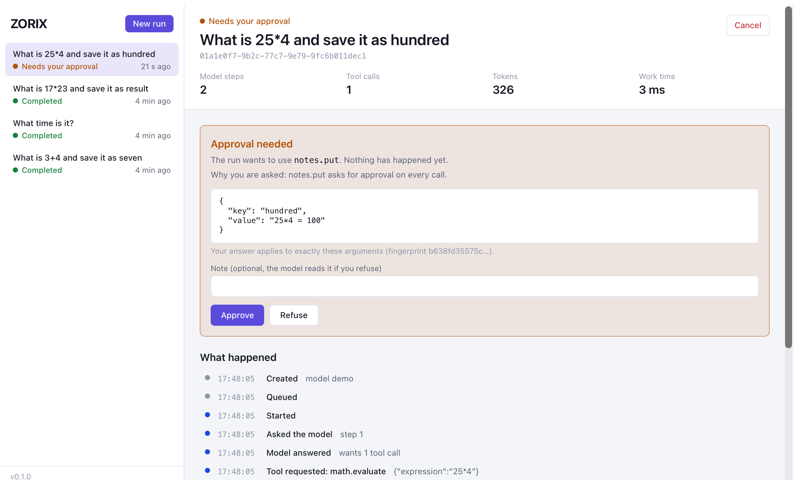

> **Status: early development.** Phases 1 to 5 are done: the **runtime**, **providers**, **memory**, **tools and integrations**, and now
> **agents**. ZORIX runs on Anthropic, OpenAI, Gemini, OpenAI-compatible servers and local Ollama models. Orchestration and workflows come in
> later phases (see the [roadmap](docs/roadmap.md)). **A cloud provider receives the conversation of a run**; use
> `--local-only` to keep everything on your computer.

A model can be powerful, but the real strength is in **integration, orchestration and control**. ZORIX is the
infrastructure under that: it decides what a model may see, what it may do, when a person must say yes, and it records
everything. It is not tied to one model or provider, and the core does not know which one is behind it.

## Highlights

- **Nothing is allowed by default.** An execution has explicit grants. A tool the model was never given is refused even
  if the model asks for it, and a prompt injected through a tool result cannot unlock anything.
- **Human in the loop that cannot be forged.** A call that changes something suspends the execution until a person answers.
  The answer is bound to the exact tool and arguments (by hash), can be given once, and survives closing the program.
- **Survives crashes.** State is saved after every step in SQLite. A stopped execution continues from its checkpoint; a
  finished tool is never run twice, and one that cannot safely be repeated asks you first.
- **Everything is recorded.** Ordered, replayable events; a summary of model, tools, timings and usage; trace spans that
  follow the OpenTelemetry GenAI names; secrets redacted from events and logs.
- **Model agnostic.** The loop talks to a small `ModelGateway` contract. [Anthropic, OpenAI, Gemini, compatible servers and
  Ollama](docs/providers.md) plug in behind it; keys stay in your system keychain; routes fall back when a provider fails.
- **Memory you control.** Facts and preferences that a person approves (a model can only propose), the earlier runs of a
  conversation, folders of documents that runs cite, and a record of past work, found by keyword and, if you choose a model, by
  meaning. What a run was given is recorded and shown. See [memory](docs/memory.md).
- **Connects to the outside, under your rules.** An [MCP client](docs/mcp.md) (stdio and HTTP, OAuth) whose tools are pinned and
  reviewed by you, [native integrations](docs/integrations.md) (HTTP, GitHub, GitLab, Jira, Slack, Discord, SQLite, Postgres)
  behind per-resource grants, a [WebAssembly sandbox](docs/sandbox.md) for code, and `zorix mcp serve` to share your memory with
  other tools, read-only.
- **Agents you can trust to change.** Reusable [agents](docs/agents.md) with instructions, [skills](docs/skills.md), tools, memory of their own and
  a list of models they may use. Every change is a version, every run records which one it used, and [evaluations](docs/evals.md) tell you whether a change made
  the agent worse. Start from four ready-made agents, chat with them in the app, or call them over MCP.
- **Agents that work together.** An agent can ask other agents, several at once and several levels deep, through one tool, `agents.delegate`.
  [Teams](docs/teams.md) say who leads and who may be asked. A parent waits without holding a worker, what it spends and may do only
  **shrinks** down the tree, an approval asked anywhere below reaches you at the top, and the app draws the whole [tree](docs/orchestration.md).
- **Work that runs by itself and stops for you.** [Workflows](docs/workflows.md) join triggers (a schedule, a webhook, an event), agents, conditions and approvals into a graph you draw. They are
  versioned, a test run asks before every action, a step that sends without asking is confirmed when you publish, and an approval is bound to exactly what you were shown.
- **Tasks that your agents pick up.** [Projects](docs/projects.md) hold tasks for you and your agents on a board, a list and a timeline. Moving an agent's task to *In progress* starts its run, a finished
  run lands in *Review* with its answer, and a project's manager plans through tools that always ask you first.
- **A workforce with a leash you set.** [Workers](docs/workforce.md) are your agents with a role, a department and someone to answer to. Five levels of autonomy, a weekly budget and a time for each task decide
  what a worker does without asking; tools that always ask still ask. A virtual manager plans the week and writes the Friday report, on a schedule that is off until you turn it on.
- **One code base, three systems.** Rust core, Tauri shell, tested on macOS, Windows and Linux.
- **Bounded.** Iterations, tool calls, tokens, cost, time, output size: every limit is explicit and fails with a clear reason.

## Screenshots

| | |
|---|---|
| 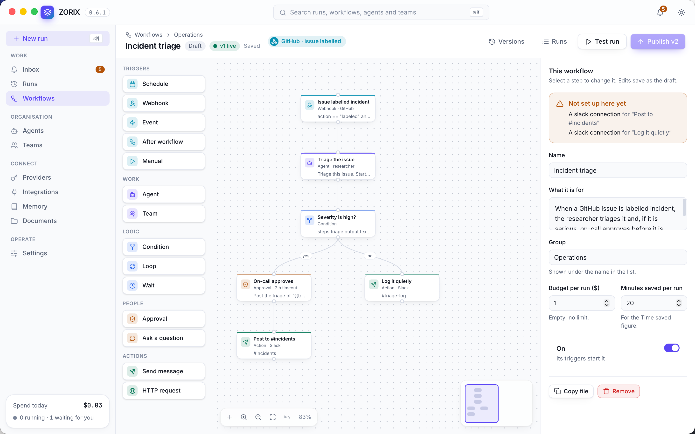 | 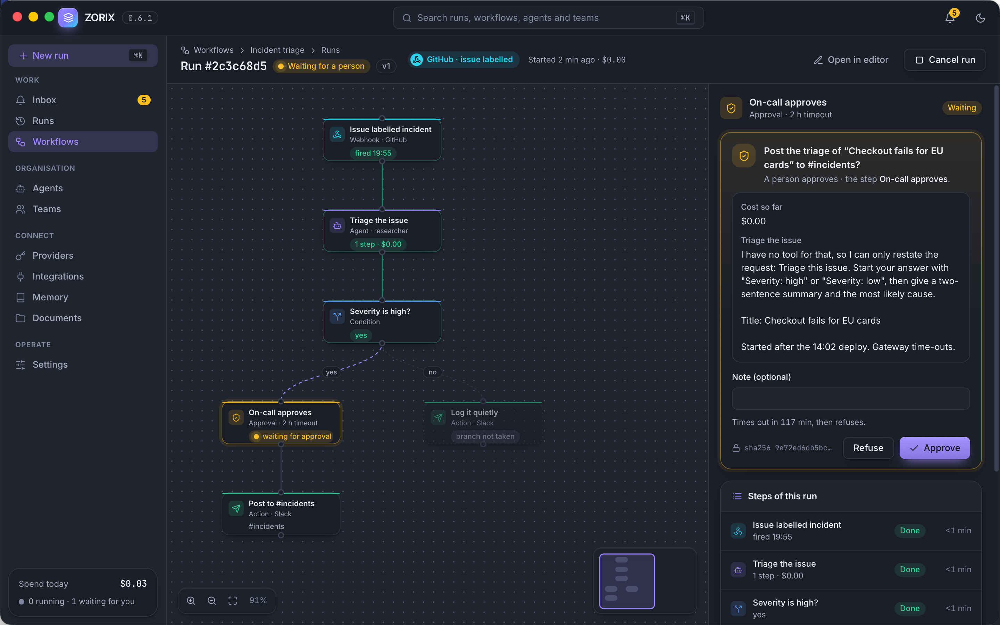 |
| A workflow on its canvas: triggers, an agent, a condition, an approval and actions. | A run stopped for a person: the card shows exactly what is being approved. |
| 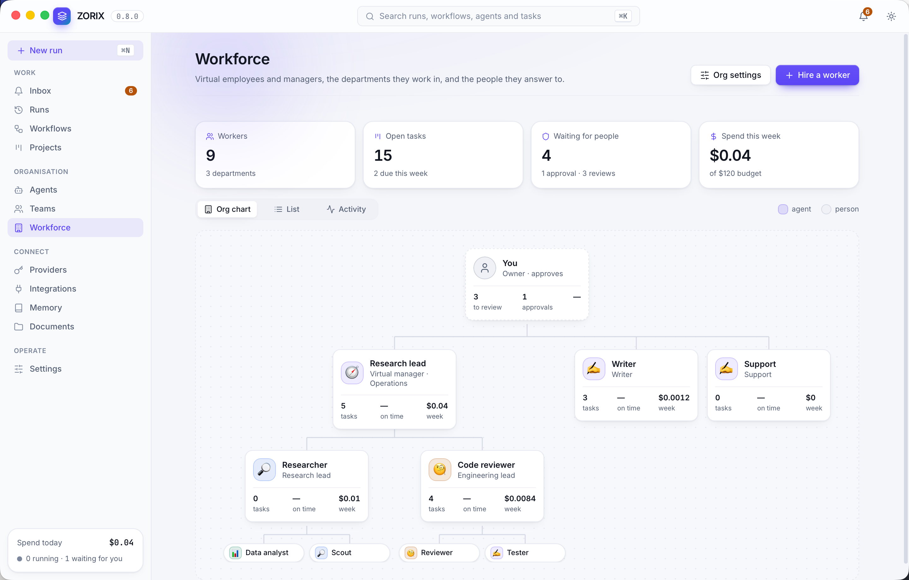 | 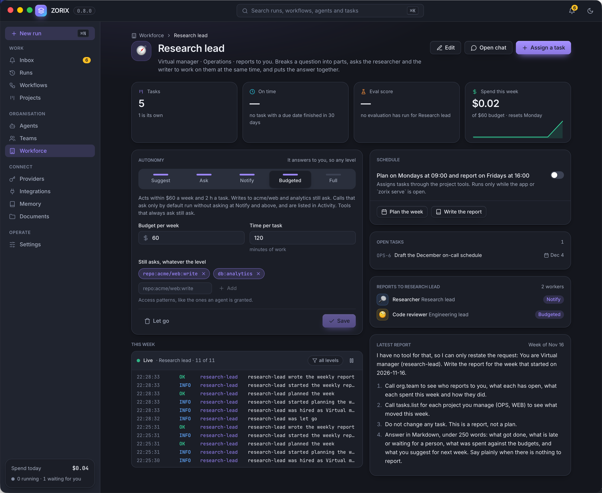 |
| The workforce: you at the top, who answers to you below, and each worker's figures. | A worker: autonomy, limits, schedule, tasks and what it did this week. |
| 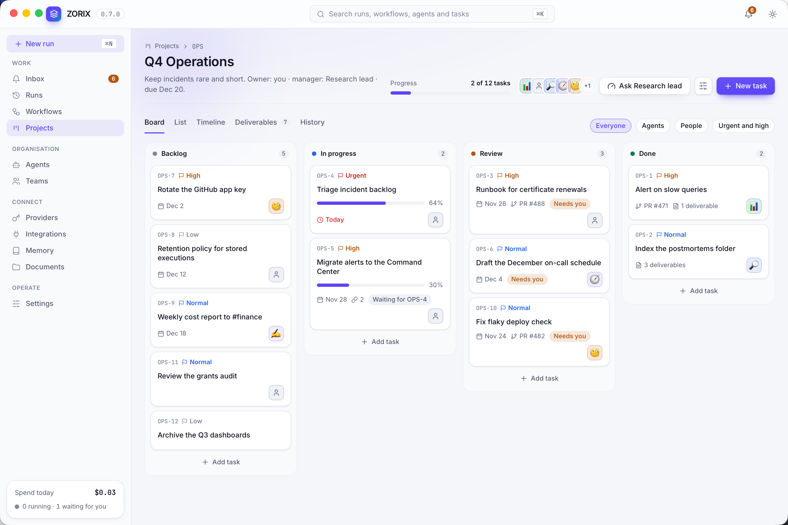 | 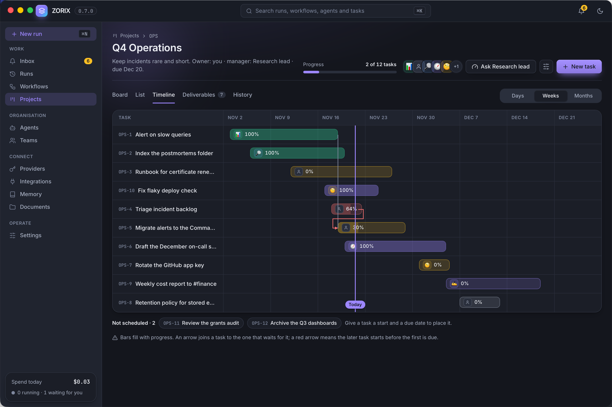 |
| The board: tasks for you and your agents, with what needs you. | The timeline: bars by progress, today, and arrows between tasks. |

| | |
|---|---|
| 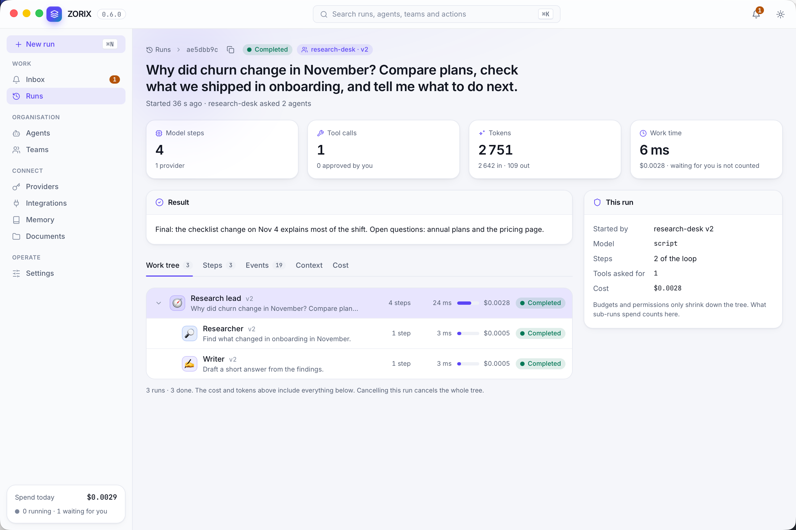 | 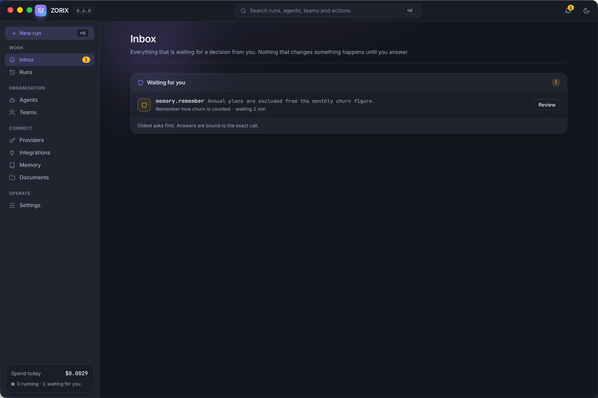 |
| The work tree: who was asked, what each cost, how it ended. | Everything waiting for a decision, oldest first, in one place. |

| | |
|---|---|
| 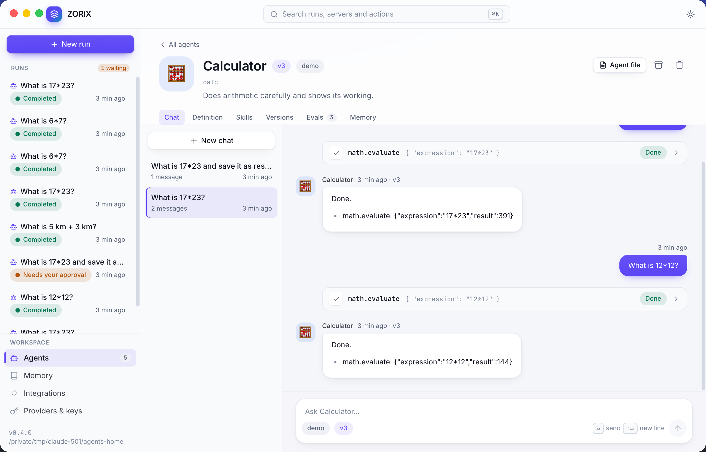 | 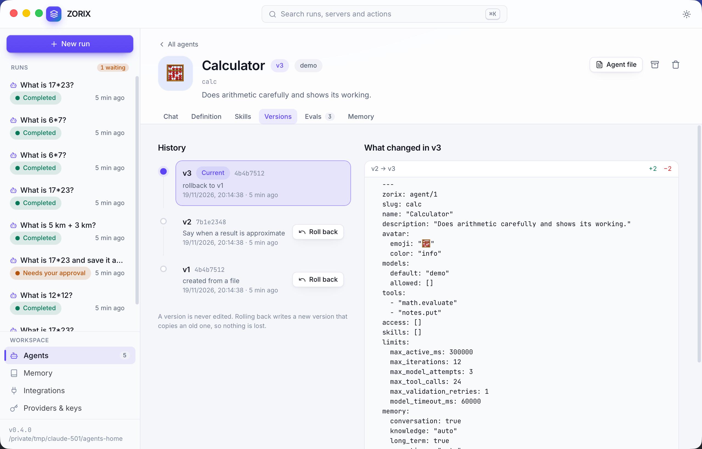 |
| Talk to an agent: tool calls and approvals sit in the conversation. | Every change is a version you can compare and roll back. |

| | |
|---|---|
| 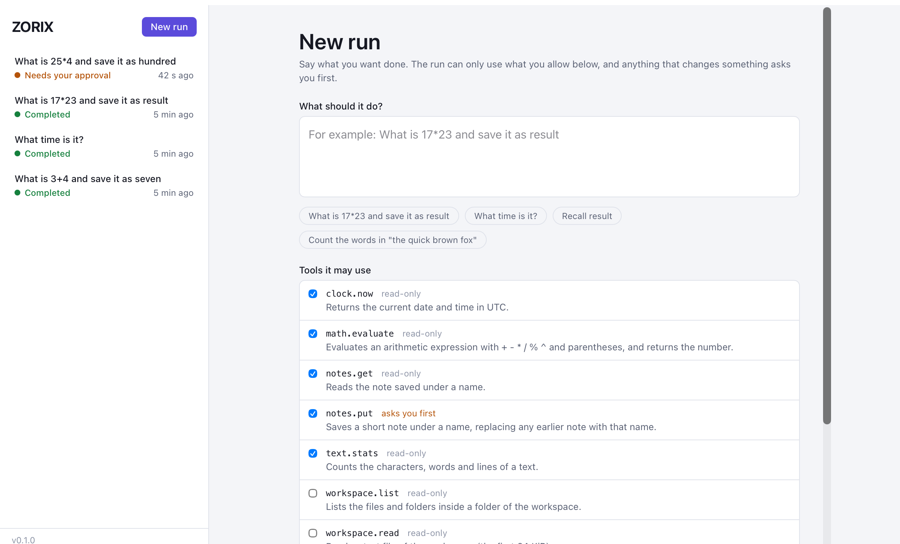 |  |
| Choose what a run may use. Anything that changes something says it asks first. | The tool, the exact arguments, why you are asked, and a fingerprint of the call. |

| | |
|---|---|
| 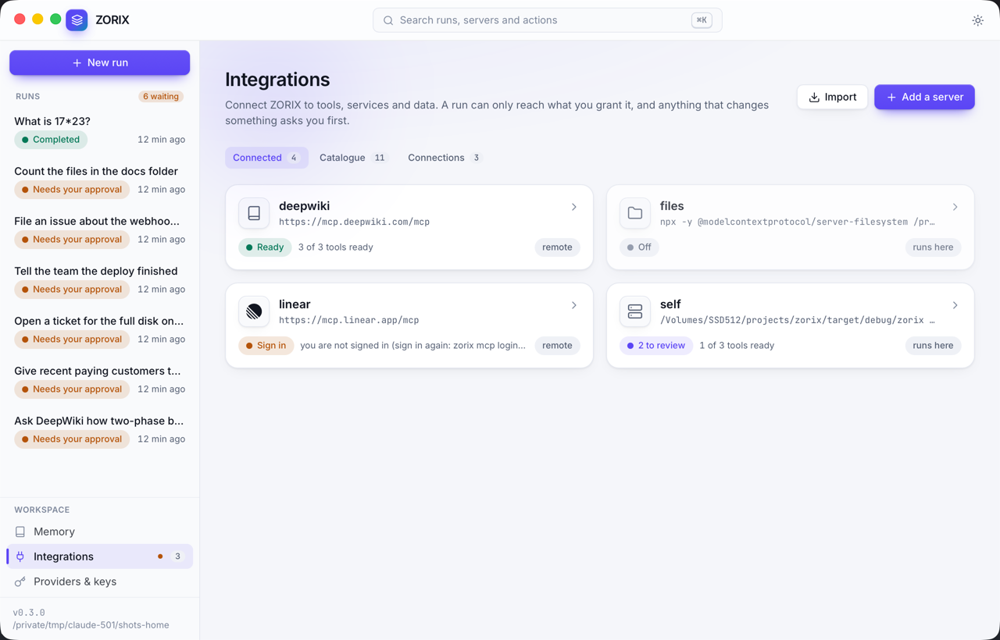 | 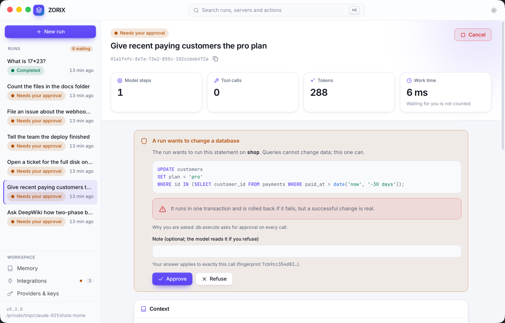 |
| Servers and services, live. Tools wait for your review. | What a change would do, with the SQL highlighted. |

## What is in Phases 1 to 6

| Area | What it does | Guide |
|---|---|---|
| Execution engine and lifecycle | Create, start, pause, resume, cancel, recover. Eleven states, validated transitions | [Runtime](docs/runtime.md) |
| The loop | Context, model call, tool calls, validation, limits, retries, timeouts | [Runtime](docs/runtime.md) |
| Context builder | Ordered, budgeted sources; memory plugs in through it | [ADR-0007](docs/adr/0007-context-builder.md) |
| Tools | MCP-shaped contract, schema validation, timeouts, output caps, eight demo tools | [Tools](docs/tools.md) |
| Permissions and policy | Grants, rules, approvals, prompt-injection containment, tenants | [Permissions](docs/permissions.md) |
| Events | Versioned, persisted, replayable, followed live | [Events](docs/events.md) |
| Persistence | SQLite, atomic commits, checkpoints, leases, idempotency, recovery | [Persistence](docs/persistence.md) |
| Observability | Spans, redaction, execution summary | [Permissions](docs/permissions.md#credentials) |
| Command line | `zorix run`, `approve`, `events`, `recover`… | [CLI](docs/cli.md) |
| Desktop app | Runs, new run, live view, approval card, providers and keys, model picker | [Desktop](docs/desktop.md) |
| Providers | Anthropic, OpenAI, Gemini, compatible servers, Ollama; keychain keys; routes and fallback | [Providers](docs/providers.md) |
| Memory | Conversation, approved facts, past work, scopes, frozen recall, calibrated token budgets | [Memory](docs/memory.md) |
| Documents | Folders of text, code, HTML and PDF; citations; keyword and embeddings search | [Documents](docs/knowledge.md) |
| MCP | Client for both protocol eras, stdio and HTTP, OAuth, pinned and reviewed tools, catalogue, import; ZORIX as a server | [MCP](docs/mcp.md) |
| Integrations | HTTP, signed webhooks, GitHub, GitLab, Jira, Slack, Discord, SQLite, Postgres; grants per resource | [Integrations](docs/integrations.md) |
| Code sandbox | JavaScript (QuickJS) and Python in WebAssembly: no network, hard limits | [Sandbox](docs/sandbox.md) |
| Agents | Versioned agents, skills, memory of their own, model allow-list, evaluations, starter agents | [Agents](docs/agents.md) |
| Orchestration | Parallel and nested delegation, structured handoff, budgets and permissions that only shrink, approvals up the tree, teams | [Orchestration](docs/orchestration.md), [Teams](docs/teams.md) |
| Workflows | Versioned graphs with schedules, webhooks and events, conditions, approvals and actions; `zorix serve` | [Workflows](docs/workflows.md) |
| Projects | Tasks for you and your agents: board, list, timeline, deliverables, history, dependencies, and a manager that plans through tools that ask | [Projects](docs/projects.md) |
| Workforce | Workers in departments, five levels of autonomy, weekly budgets, a manager that plans and reports | [Workforce](docs/workforce.md) |

## Install

Prebuilt installers will be attached to each [release](https://github.com/LuisPeixoto/zorix/releases). The first releases
are not signed (see [distribution](docs/distribution.md)). To build from source you need Rust 1.97 or newer and, for the
desktop app, Node.js 22 or newer:

```bash
git clone https://github.com/LuisPeixoto/zorix.git && cd zorix
cargo build --release -p zorix-cli        # target/release/zorix
cd apps/desktop && npm install && npm run tauri build
```

## Quick start

```bash
export ZORIX_HOME=$(mktemp -d)/zorix                 # a throwaway data folder

zorix run "What is 17*23 and save it as result" \
  --allow math.evaluate --allow notes.put --approve never
# runs math.evaluate, then stops: notes.put changes something and asks first (exit code 3)

zorix list
zorix approve <execution-id>                          # from another process; continues from the checkpoint
zorix events  <execution-id>                          # the complete, ordered record
```

With a real model (the conversation goes to that provider, or stays here with Ollama):

```bash
zorix provider set-key anthropic                      # hidden prompt; kept in the system keychain
zorix run "What is 17*23?" --allow math.evaluate      # uses Anthropic when it has a key, else the demo model
zorix run "What time is it?" --allow clock.now --model ollama/qwen3:1.7b --local-only
```

More in [getting started](docs/getting-started.md). To use the runtime from Rust:

```bash
cargo run -p zorix-runtime --example embed
```

## Documentation

| Guide | |
|---|---|
| [Getting started](docs/getting-started.md) | Build it, run the first activity |
| [The runtime](docs/runtime.md) | Executions, lifecycle, loop, limits, failures |
| [Permissions, policy and approvals](docs/permissions.md) | What an AI may do, and how a person decides |
| [Tools](docs/tools.md) | The contract, the built-in tools, writing your own |
| [Events](docs/events.md) | Every event and how to follow them |
| [Persistence and recovery](docs/persistence.md) | What is saved, what happens after a crash |
| [Providers, models and routing](docs/providers.md) | Anthropic, OpenAI, Gemini, Ollama; keys; routes and fallback |
| [Memory](docs/memory.md) | What ZORIX remembers, who writes it, how a run finds it, how to forget |
| [Documents](docs/knowledge.md) | Indexing folders, citations, embeddings |
| [MCP servers](docs/mcp.md) | Using, trusting and serving MCP |
| [Integrations](docs/integrations.md) | Connections, grants and what each tool guards |
| [The code sandbox](docs/sandbox.md) | JavaScript and Python, limits and files |
| [Agents](docs/agents.md), [Skills](docs/skills.md), [Evaluations](docs/evals.md) | Reusable agents you can version and test |
| [Orchestration](docs/orchestration.md), [Teams](docs/teams.md) | Agents asking agents: delegation, trees, budgets, approvals |
| [Workflows](docs/workflows.md) | Triggers, steps, people, versions, the host and webhooks |
| [Projects](docs/projects.md) | Tasks that agents pick up, the board, the timeline and the manager |
| [Workforce](docs/workforce.md) | Workers, departments, autonomy, budgets and the manager's week |
| [Command line](docs/cli.md) | Every command, option and exit code |
| [Desktop app](docs/desktop.md) | The Tauri app |
| [Design system](docs/design-system.md) | Tokens, themes and the component kit |
| [Architecture](docs/architecture.md) | Layers, contracts, decisions; the [ADRs](docs/adr) |
| [Technology comparison](docs/research/runtime-landscape.md) | LangGraph, OpenAI Agents SDK, ADK, Temporal, MCP and others: what we took, what we built |
| [Testing](docs/testing.md) | How each required case is proven |
| [Engineering guidelines](docs/engineering-guidelines.md) | The rules every change follows, and where ZORIX enforces them |
| [Distribution](docs/distribution.md) | Installers, signing, releases |
| [Troubleshooting](docs/troubleshooting.md) | Symptom, cause, fix |
| [Roadmap](docs/roadmap.md) | The eleven phases |

## Project layout

```
crates/
  zorix-core      model and contracts: lifecycle, permissions, events, the traits everything depends on (no I/O)
  zorix-runtime   the engine, loop, tools, policy, context, events, in-memory repository
  zorix-store     SQLite persistence and the data folder lock
  zorix-sim       simulated models: scripted, failure-injecting, rule-based demo
  zorix-tools     built-in demonstration tools
  zorix-cli       the `zorix` command line
apps/desktop      Tauri 2 shell (src-tauri) and the Svelte 5 interface (src)
docs/             guides, architecture, decision records, research
```

## Contributing

Bug reports, documentation, tests and code are welcome. Read [CONTRIBUTING.md](CONTRIBUTING.md), the
[engineering guidelines](docs/engineering-guidelines.md) and the
[code of conduct](CODE_OF_CONDUCT.md). Report vulnerabilities privately, as described in [SECURITY.md](SECURITY.md).

## License

[MIT](LICENSE)
