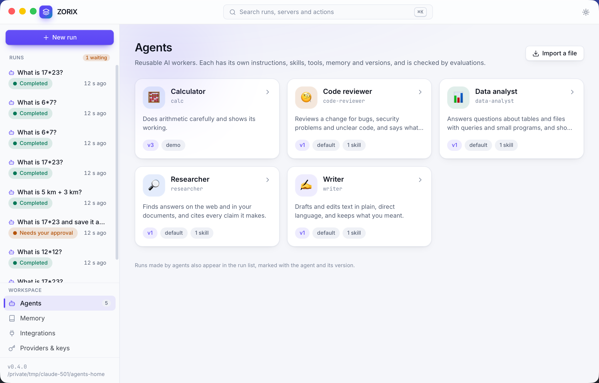
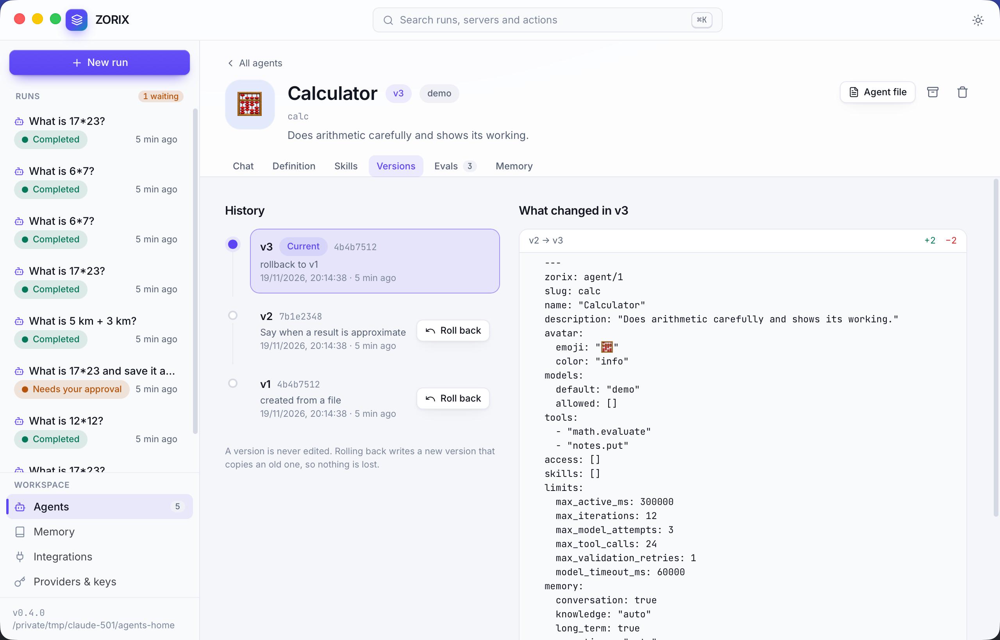
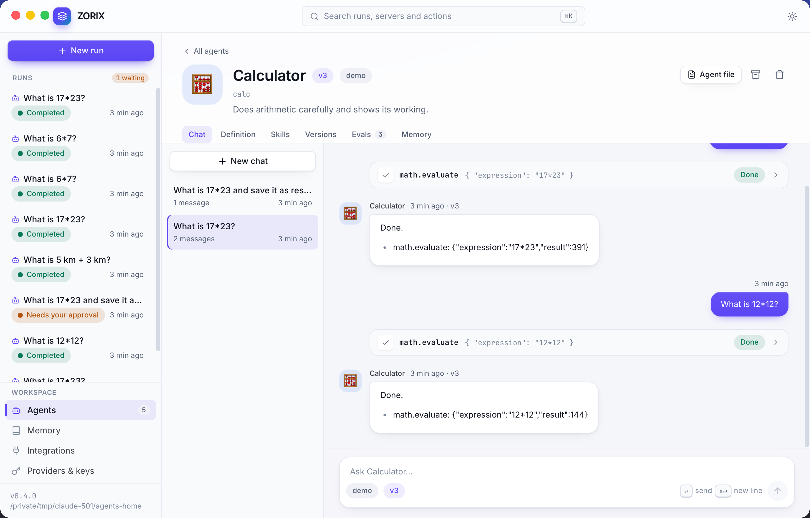

# Agents

An **agent** is a reusable AI worker: a name and a face, instructions, skills, the tools and resources it may use, its own
memory, the models it may run on, and limits. You make it once, talk to it, change it over time, and check that a change did not
make it worse. Agents create ordinary [executions](runtime.md): everything that holds for a run (permissions, approvals, limits,
events) holds for a run made by an agent. The design is in ADRs [0024](adr/0024-agents-and-versions.md) to
[0028](adr/0028-evals.md).



## Make one

- **From a template.** `zorix agent add --template researcher` (or *Add from templates* in the app) installs a ready-made agent
  with a skill and a few evaluation cases. The four templates are `researcher`, `code-reviewer`, `data-analyst` and `writer`.
  Once added they are ordinary agents.
- **From options.** `zorix agent create calc --name Calculator --model demo --tool math.evaluate --instructions "You calculate carefully."`
- **From a file.** `zorix agent import agent.md`, or paste a file in the app (*Import a file*).
- **In the app.** The *Definition* tab is the whole agent as a form.

## What an agent is made of

| Part | Meaning |
|---|---|
| `slug` | Its short name: lowercase letters, digits and dashes, up to 48. Never changes |
| `name`, `description`, `avatar` | What people see. The description (280 characters) is also what MCP clients see |
| `instructions` | Markdown, up to 50,000 characters. What it is told |
| `skills` | [Skills](skills.md) it can load, pinned by content hash |
| `tools` | Tool patterns it may use (`memory.search`, `math.*`) |
| `access` | Resources it may reach: `http:HOST`, `repo:OWNER/REPO[:write]`, `jira:KEY`, `chat:slack:#channel`, `db:NAME[:write]`, `code:python`, `mcp:SERVER`, `read:PATTERN`, `write:PATTERN`. The same words as the `--allow-…` flags |
| `models` | `default` (a model, route, alias or `demo`) and `allowed` (`provider/model`, `provider/*`, `demo` or `*`; empty means any) |
| `limits`, `memory`, `agent_memory`, `params`, `expected_output`, `metadata` | Run limits, what memory it uses, whether it has memory of its own, output size and effort, a JSON Schema for the answer, free labels |

## The agent file

An agent exports to one Markdown file: the definition as a header, the instructions as the body. The format is strict and
the output is deterministic, so a file can live in git and diffs are meaningful. `parse(render(x)) == x`.

```markdown
---
zorix: agent/1
slug: calc
name: "Calculator"
description: "Does arithmetic."
avatar:
  emoji: "🧮"
  color: "info"
models:
  default: "demo"
  allowed: []
tools:
  - "math.evaluate"
access: []
skills:
  - "checklist@sha256:9d41…"
limits: {}
agent_memory: true
---

You calculate carefully.
```

`zorix agent export calc [--version N] [-o FILE] [--with-skills DIR]` writes it. A skill named without a hash takes the library's
current version; a pinned skill must be in the library, which `zorix agent import FILE --skills DIR` does for you from the folders
that `--with-skills` wrote. Unknown keys are refused, so a typo is not silently ignored.

## Versions

Saving never edits anything. It writes **version N+1**, and only when the content changed (the version's hash is the SHA-256 of
its canonical JSON). `zorix agent versions calc`, `diff calc 1 2` and `rollback calc 1` show, compare and go back: a rollback
writes a **new** version that copies the old one, so nothing is lost. Every run records the agent, the version and the hash it
used, so you can always say which definition produced an answer.



## How an agent becomes a run

`zorix run --agent calc "What is 17*23?"` (or the chat, or `zorix.run_agent` over MCP) builds an execution:

1. **Model.** The one asked for, else the agent's default. It must match `models.allowed`. The router drops candidates outside the
   list, so a fallback can never leave it, and the runtime checks the model that actually answered.
2. **Instructions.** The agent's, plus an index of its skills (names and descriptions only).
3. **Grants.** The agent's tools and access, plus the skill tools. Flags on `run` and the New run form can only **narrow** this:
   what is allowed is allowed by both sides.
4. **Limits** are the smaller of the agent's and the request's; **memory** switches are on only if both are.
5. **Approvals** are unchanged: anything that changes something still asks a person.

## Memory of its own

An agent has an **agent scope**: facts only that agent sees (`zorix memory add "…" --scope agent:calc`, or the *Memory* tab). It
still sees global, project and conversation memory. A run proposes a fact for itself with `memory.remember` and
`scope: "agent"`; as always, **a person approves every memory** ([memory](memory.md)). Other agents and plain runs never see it.

## Chat

The *Chat* tab is a conversation with the agent: your messages, its answers as Markdown, each tool call as a card in the flow, and
an approval right where it is asked. While a model is still writing, the text appears as it arrives; when the step is stored it
replaces the draft. A conversation is a normal conversation, so *Continue* on a run opens it here.



## Start a run from New run

The New run form has a **Run as** picker. With an agent chosen the form shows what the agent keeps (tools, access, skills,
limits) and the sections that can still be narrowed: the model (it must be allowed) and the memory switches. The run view shows
an **agent · vN** chip that opens the agent's chat.

## From the command line

```
zorix agent list [--all] | show NAME [--version N] | create NAME … | edit NAME | import FILE [--as NAME] [--skills DIR]
zorix agent export NAME [-o FILE] [--with-skills DIR] | versions NAME | diff NAME A B | rollback NAME N
zorix agent archive NAME [--undo] | remove NAME --yes | add --template NAME [--as NAME] | templates
zorix skill list | show NAME | import PATH | remove NAME | gc
zorix eval add AGENT FILE.json | list AGENT | remove AGENT CASE | run AGENT [--model M]… | runs AGENT | show RUN | compare A B
zorix run --agent NAME [--agent-version N] [--input JSON] [narrowing flags] "…"
zorix list --agent NAME
```

`edit` opens the agent file in `$VISUAL` or `$EDITOR`; saving makes a new version, an unchanged file makes none.

## Over MCP

`zorix mcp serve` always lists agents (`zorix.agents`: name, description, default model, version, skills; never the
instructions). With `--allow-runs` it also offers `zorix.run_agent {agent, prompt, input?, model?, wait_seconds?}`. A client's run
gets **only what the person allowed when starting the server**: `--allow TOOL`, `--allow-read`, `--allow-write` and
`--allow-access http:HOST` (any access entry), intersected with what the agent has. Approvals still wait in ZORIX; see [mcp](mcp.md).
