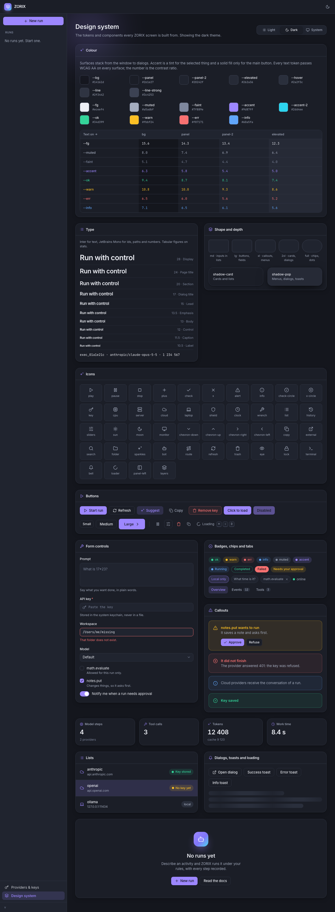

# Design system

Everything the desktop app draws comes from one set of **tokens** and one small **component kit**. Light is the default
theme; Dark and System are one click away. The kit lives in `apps/desktop/src/lib/ui/`, the tokens in
`apps/desktop/src/app.css`, and both are shown live in the app on the **Design system** screen
(<kbd>Ctrl</kbd>/<kbd>⌘</kbd> + <kbd>⇧</kbd> + <kbd>D</kbd>, or the sidebar item in development builds).

| Light | Dark |
|---|---|
|  |  |

## Principles

- **Calm surfaces, one accent.** Surfaces stack from the window to dialogs (`bg` → `panel-2` → `panel` → `elevated`),
  separated by 1px lines. The violet accent is a *tint with accent text* for what is selected or active, and a *solid fill*
  only for the one main action of a screen.
- **Colour is never the only signal.** A state has a word and an icon or dot as well as a colour.
- **Readable by rule.** Text tokens must pass WCAG AA on every surface in both themes; a test enforces it.
- **A desktop app, not a page.** Compact type (13px body), `user-select: none` by default, slim scrollbars, real focus rings.
- **The interface decides nothing.** Components show state; rules live in Rust (see [desktop](desktop.md)).

## Tokens

Tokens are CSS variables chosen by `data-theme="light" | "dark"` on `<html>` and mapped to Tailwind, so classes read like
`bg-panel`, `text-muted`, `border-line`, `bg-accent-soft`. Opacity modifiers work (`bg-err/10`).

| Token | Light | Dark | Use |
|---|---|---|---|
| `bg` | `#f5f6fa` | `#14161d` | The window |
| `panel` | `#ffffff` | `#1b1e27` | Cards, toolbar, inputs when focused |
| `panel-2` | `#f9fafc` | `#20242f` | Sidebar, headers of cards, wells, input background |
| `elevated` | `#ffffff` | `#262a36` | Dialogs, menus, toasts |
| `hover` | `#eff1f6` | `#2a2f3c` | Hovered rows and buttons |
| `line` / `line-strong` | `#e5e8f0` / `#d4d9e4` | `#2f3442` / `#3c4253` | Borders, dividers |
| `fg` | `#121621` | `#eceef4` | Text |
| `muted` | `#566074` | `#a5adbf` | Secondary text |
| `faint` | `#7d879b` | `#7f889e` | Hints and icons, never body text |
| `accent` / `accent-2` | `#5b45f5` / `#0891b2` | `#9d87ff` / `#2dd4ee` | Brand, selection, primary actions |
| `accent-fg` | `#ffffff` | `#14161d` | Text on a solid accent |
| `accent-soft` / `select` | accent at 10% / 14% | accent at 16% / 24% | Tints for active and selected |
| `ok` `warn` `err` `info` | `#047857` `#b45309` `#d12020` `#2563eb` | `#34d399` `#fbbf24` `#f87171` `#60a5fa` | Status |

**Type.** Inter Variable for text and JetBrains Mono for ids, paths, keys and numbers (both bundled, see
`apps/desktop/THIRD-PARTY.md`). The scale replaces Tailwind's: `2xs` 10.5 · `xs` 11.5 · `sm` 12 · `base` 13 (body) · `md` 13.5 ·
`lg` 15 · `xl` 17 · `2xl` 20 · `3xl` 24 · `4xl` 28. Use `tabular-nums` for figures that change.

**Shape and depth.** `rounded-lg` for buttons and fields, `rounded-xl` for callouts and menus, `rounded-2xl` for cards and
dialogs, `rounded-full` for chips and dots. `shadow-card` for cards, `shadow-pop` for what floats.

**Motion.** 120–200 ms, `--ease-out`. Fade and scale for dialogs, fly for toasts. Everything is disabled by
`prefers-reduced-motion`.

**Utilities.** `.brand-gradient` (the logo tile, empty states), `.glow` (the haze behind a page header), `.live-dot` (a pulsing
ring for something happening now), `.skeleton` (loading), `.mono` (monospace without ligatures), `.selectable` (text people
copy: results, errors, ids).

## Themes

Light is the default. The toolbar button cycles light → dark → system, and the choice is remembered (`localStorage`, key
`zorix.appearance`). `src/early.ts` sets the theme before the first paint, and the native window background follows it, so
there is no flash. In a development build, `VITE_START_THEME=dark` forces a theme without saving it.

## Components

Import from `src/lib/ui/index.ts`. All accept `class`; interactive ones have hover, pressed, focus-visible, disabled
(and loading) states.

| Component | Props and notes |
|---|---|
| `Button` | `variant` primary · secondary · ghost · danger · subtle; `size` sm · md · lg; `icon`, `iconRight`, `loading` (keeps its width). One primary per screen |
| `IconButton` | `icon`, `label` (required: screen reader name and tooltip), `variant`, `size` |
| `Field` | `label`, `hint`, `error`, `required`. Passes `id` and `describedby` to the control through its snippet |
| `Input` · `Textarea` · `Select` | `bind:value`, `invalid`, `mono`, `icon`, `trailing` (Input) |
| `Checkbox` · `Switch` | `bind:checked`, label as children, `description` |
| `Segmented` · `Tabs` | `options`/`tabs`, `bind:value`; arrow keys move in `Segmented` |
| `Badge` | `tone` ok · warn · err · info · muted · accent; `variant` soft · outline · solid; `dot`, `live` |
| `Chip` | `selected`, `onclick`, `onremove` |
| `Card` | `title`, `icon`, `padding`, `interactive`; snippets `actions`, `footer` |
| `Callout` | `tone`, `title`, `icon`; snippet `actions`. Errors use `role="alert"` |
| `Stat` | `label`, `value`, `detail`, `icon` |
| `List` · `ListRow` | The divided list; `ListRow` takes `active` and `onclick` |
| `Modal` | `bind:open`, `title`, `icon`, `size`; snippet `footer`. Traps focus, closes on Escape and backdrop |
| `Toasts` + `toast` | Mount `Toasts` once; call `toast.ok / err / info(text)` |
| `EmptyState` · `PageHeader` | Icon tile with the brand gradient; page title, subtitle and actions |
| `Icon` · `Spinner` · `Dot` · `Kbd` · `Divider` · `Skeleton` | Small parts |
| `tooltip` · `trapFocus` | Actions. `tooltip` is plain text only |

**Tones.** Never write tone classes by hand: `toneClass(tone, kind)` returns the Tailwind classes for `text`, `dot`, `soft`,
`border`, `solid` or `callout`. State-to-tone mapping stays in `format.ts` (`stateTone`).

**Icons.** A Lucide-style path on a 24px grid in `src/lib/ui/icons.ts`; add one line to add an icon. They are static
markup written in that file and never come from user input.

## Do and don't

- **Do** use `Field` around every control so labels and errors are connected.
- **Do** give icon-only buttons a `label`.
- **Do** keep a solid accent to the one thing a screen wants you to do.
- **Don't** invent colours or sizes in a screen; add a token or use a scale step.
- **Don't** use `faint` for text people must read.
- **Don't** rely on colour alone to say a state.

## Accessibility

- Contrast is tested: `fg` ≥ 7, `muted` and every status colour and `accent` ≥ 4.5, `faint` ≥ 3, and the text on a solid
  accent ≥ 4.5, on every surface in both themes (`src/lib/contrast.test.ts` reads `app.css`).
- Focus is always visible: a 2px accent outline, and a soft ring on fields.
- Dialogs trap focus and give it back; Escape closes them. Toasts are announced politely, errors assertively.
- Motion respects `prefers-reduced-motion`.

## Changing the system

1. Edit the token in `app.css` (both themes) and run `npm test`; the contrast test says if a pair got unreadable.
2. Open the Design system screen in both themes and look.
3. Retake the two screenshots: serve with `VITE_START_VIEW=design VITE_START_THEME=light npx vite` (and `dark`) and capture the
   full page with a headless browser.
