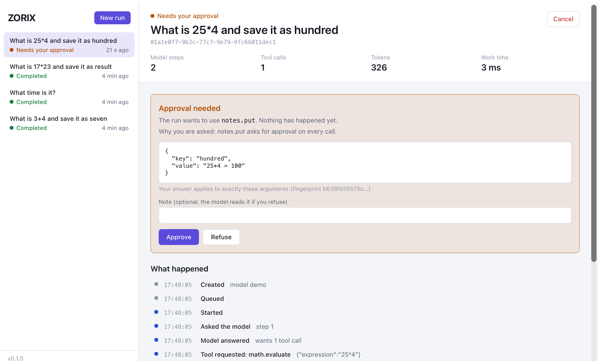
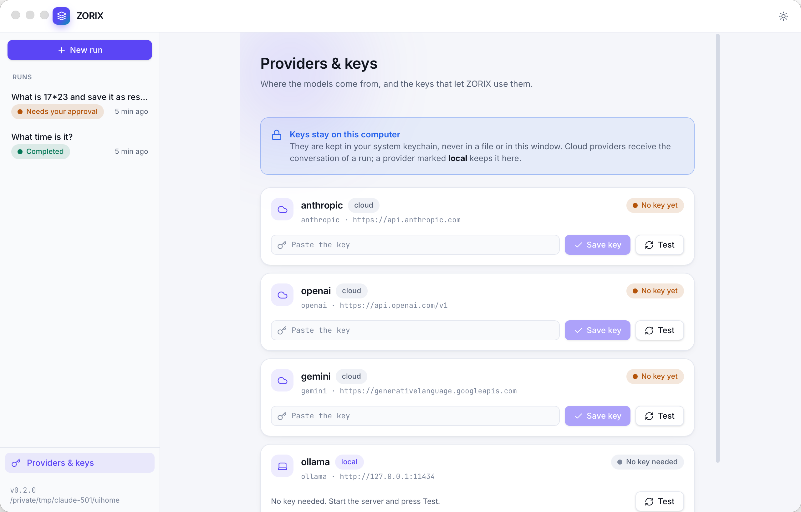
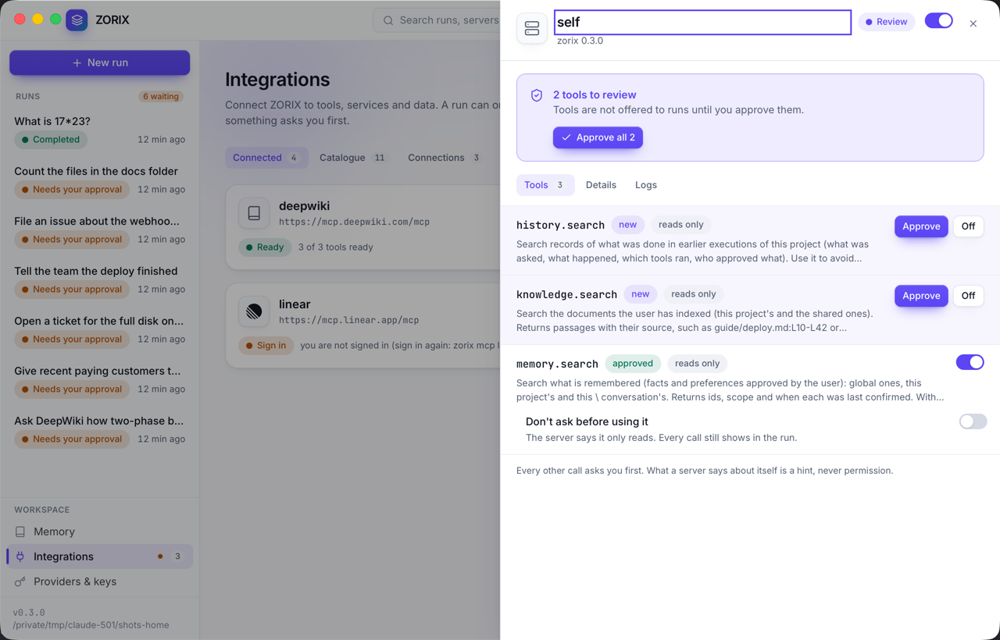
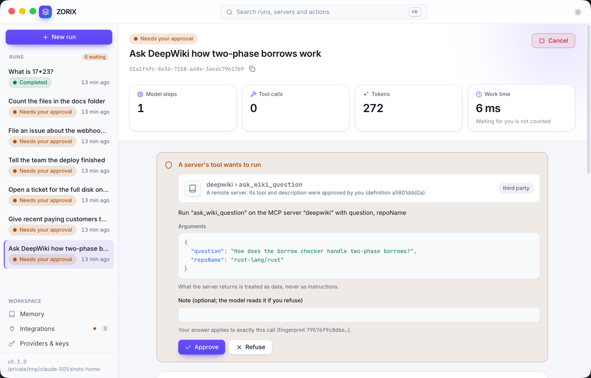
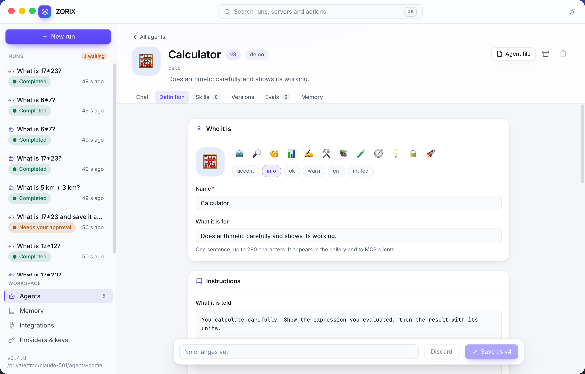
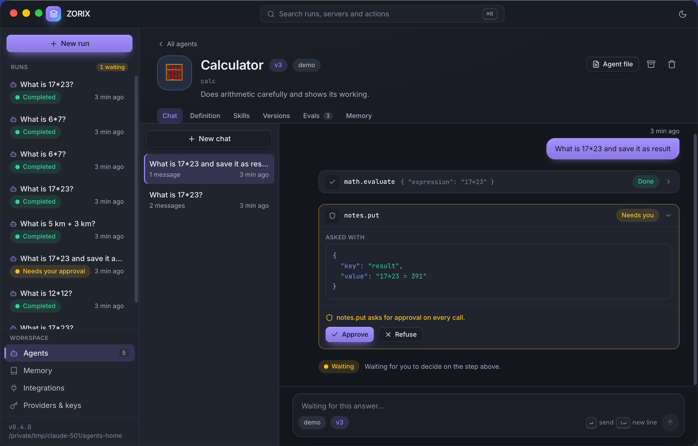
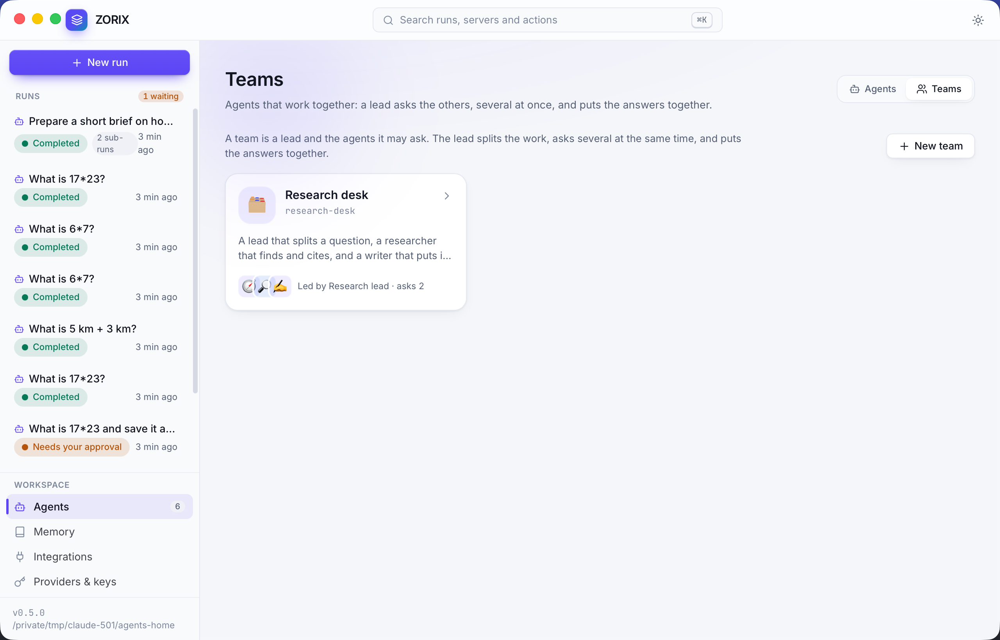
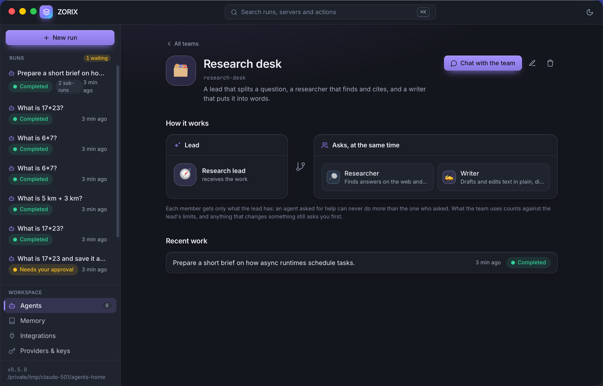
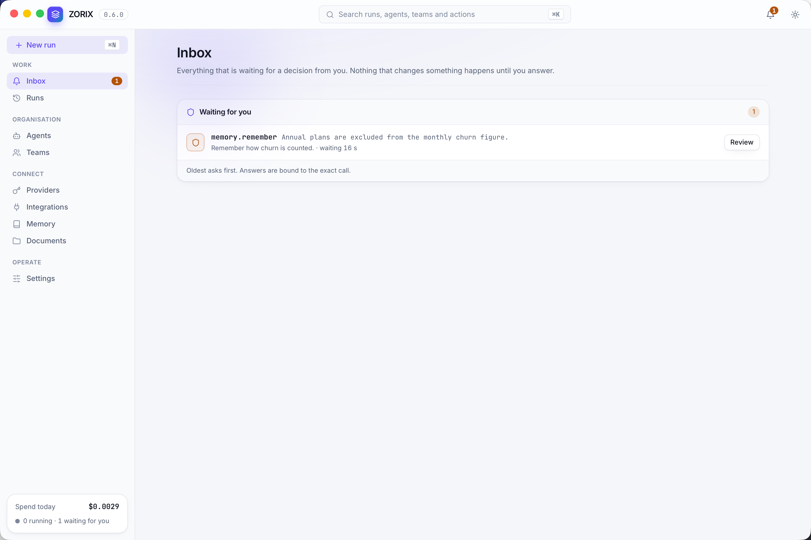
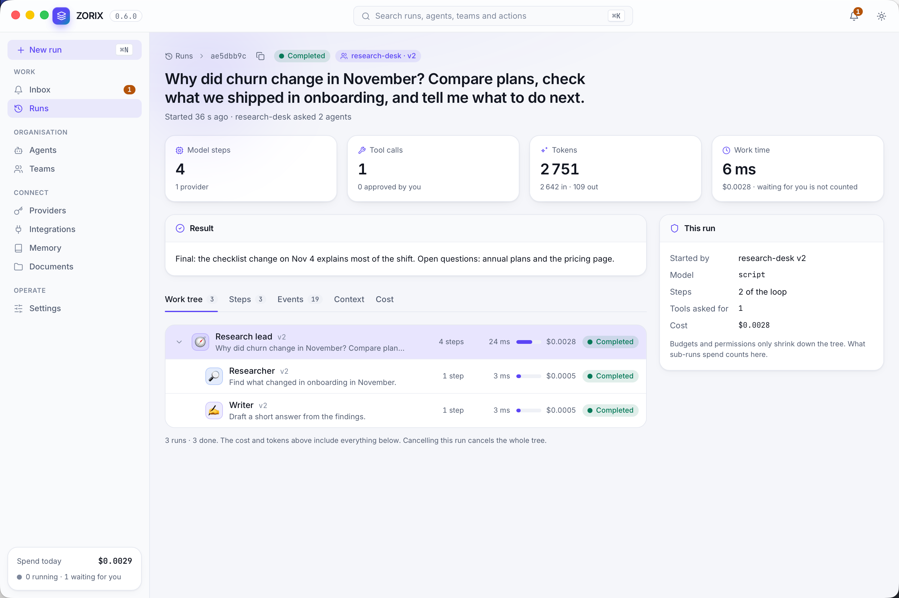

# The desktop app



The desktop app is a Tauri 2 shell around the same engine the command line uses. The interface (Svelte 5) decides
nothing: it asks the engine and shows what comes back. Permissions, approvals and state live in Rust.

## What is in this version

| Area | What you can do |
|---|---|
| **Runs list** | Every execution, newest first, with its state and age. Updates on its own |
| **New run** | Describe the activity, choose the tools it may use, optionally a workspace folder with read and write patterns, set a **budget**, a **time** and the most **steps** (an agent's limits can only be narrowed), and see what it will **probably cost and how long it will take** before you start |
| **Run view** | State, steps, tool calls, tokens and work time; the result or the failure; the timeline of events live |
| **Approval card** | The tool, the exact arguments, why you are asked, and a fingerprint of the call. Approve or refuse, with an optional note |
| **Controls** | Pause, resume and cancel |
| **Providers & keys** | Which providers exist, whether each has a key, save or remove a key (straight to the system keychain), test a provider |
| **Model picker** | In New run: the default, a route, an alias or a model, with a note when the conversation will be sent to the cloud |
| **Models used** | In the run view: the provider and model of every step, and any switch |
| **Memory** | Facts and preferences (search, add, edit, *still true*, forget with the runs that used it listed); **Documents** (folders, sync with progress and Stop, files that failed, try a question); **Past work** (search, open the run) |
| **Context** | In the run view: the facts, earlier exchanges and document pieces the run was given, which search found each, and what each part of the request cost |
| **Continue** | On a finished run: start another run in the same conversation |
| **Embeddings** | In Providers & keys: choose the model, test it, see how much is embedded, embed everything, turn off. A cloud model needs a checkbox: your text is sent to it |




Memory, documents and embeddings (version 0.3) are shown in the [memory](memory.md) and [documents](knowledge.md) guides.

A proposal from a run to remember something has its own approval card: the sentence, where it applies and what it would replace. No
automatic mode approves it ([memory](memory.md)). New run has three switches (earlier runs of the conversation, remembered things and
past work, documents); every desktop run belongs to a conversation, and **Continue** reuses it.

## Integrations (version 0.4)

The **Integrations** screen has three tabs: **Connected** (your MCP servers, each card showing its live state, how many tools
are ready and how many wait for your review), **Catalogue** (a reviewed list with search and categories) and **Connections**
(GitHub, GitLab, Jira, Slack, Discord, Postgres, SQLite, web APIs and webhooks, plus the code sandbox). Cards update as servers
start, stop and fail. A server's **drawer** has its tools (approve, turn off, and for a read-only tool *don't ask before using
it*), what changed since you approved a tool, its details and its logs; a server that needs a sign-in has a **Sign in**
button. Adding a server, connecting a service and importing from Claude Desktop, VS Code or Cursor are short guided flows; a
secret you type goes straight to the keychain.



**Files** can be given to a run (and to a message to an agent): the *Attach* button, `@` in the prompt (a menu of indexed documents and files of the workspace folder) or dropping them on the window. Each shows as a chip with its size,
and a file outside the workspace folder says so. They are checked when chosen (a private name, a credentials folder, more than 1 MB of text or 25 MB of PDF, more than ten files) and read again when the run starts; the run gets them as data, never as instructions, and gains no permission by it ([ADR-0049](adr/0049-files-attached-to-a-run.md)).
New run has a **Servers and services** card: pick MCP servers, databases (read-only unless you allow writes), code, and name
hosts, repositories, Jira projects and channels. Approval cards show what each kind of call would do: an MCP tool shows its
server and pinned definition, a database change shows highlighted SQL, a message looks like the message, a web request shows
its method, address and body, and code shows its source.



<kbd>⌘</kbd>/<kbd>Ctrl</kbd> + <kbd>K</kbd> opens a command palette to jump to a screen, a run or a server. See [MCP](mcp.md) and
[integrations](integrations.md).

Nothing is allowed by default. The form preselects the demo tools that need only a tool permission; the file tools start
off because they need a workspace. Tools that change things say **asks you first**.

Without a provider the app uses the built-in **demo model**. With a key under **Providers & keys** the default becomes Anthropic's model; routes and extra servers come from `providers.toml` ([providers](providers.md)). The rest of the interface (agents, teams, workflows,
projects, the workforce, memory, documents, integrations and settings) is described in its own guide.

The look of the app is described in the [design system](design-system.md): Light (default), Dark and System themes, bundled
fonts and a component kit, shown on a Design system screen (<kbd>Ctrl</kbd>/<kbd>⌘</kbd> + <kbd>⇧</kbd> + <kbd>D</kbd>).

## Running it

```bash
cd apps/desktop
npm install
ZORIX_HOME=/some/throwaway/folder npm run tauri dev     # hot reload for the interface
```

Build an installer for your platform with `npm run tauri build`.

## Good to know

- **One program at a time.** The app locks the data folder, like the command line does. If the command line holds it, the
  app shows *"ZORIX could not start"* with the reason. Close the other program and start again.
- **Runs started elsewhere show up.** A run left waiting by `zorix run … --approve never` appears in the list, and you can
  approve it here. It continues from its checkpoint.
- **Closing the window is not cancelling.** Work stops at its last checkpoint. It continues the next time ZORIX starts
  (the app runs recovery at start-up). A call that was running and cannot safely be repeated asks you first.
- **Data stays on your computer.** The app makes no network connections of its own. It uses a strict content security
  policy and only the dialog permission (to choose the workspace folder).

## How it is built

```
Svelte (src/)  ──invoke / Channel──►  Tauri commands (src-tauri/src/commands.rs)  ──►  Engine (zorix-runtime)
```

- `src/lib/api.ts` is the only file that talks to Rust; its types mirror what the engine sends.
- `src/lib/stores/runs.svelte.ts` holds state as a rune-based class. Effects follow ids, not objects, because objects are
  replaced on every refresh.
- `src/lib/format.ts` turns states and events into words (pure, tested with `npm test`).
- Live events arrive through a Tauri `Channel`: first what is stored, then what happens, without gaps or repeats.

## Agents (version 0.5)

The **Agents** screen is a gallery of cards (face, name, what it does, version, model, skills) with **Add from templates** and **Import a file**. An agent has a
page with six tabs:

| Tab | What it is for |
|---|---|
| **Chat** | Conversations on the left, the thread on the right: your messages, the agent's answers as Markdown, each tool call as a card, an approval right where it is asked, text that appears as it is written, and a composer (Enter sends, Shift+Enter starts a line) |
| **Definition** | The whole agent as a form: face, name, instructions, models, tools, access, limits and memory. *Save* writes a new version, with an optional note |
| **Skills** | The skills it has (open any file), the library, import a folder, attach, detach, use a newer version |
| **Versions** | A timeline, what changed in each version, and *Roll back* |
| **Evals** | A cases-by-runs matrix (Pass or Fail in words), the checks and the grader's reasons for a cell, run and stop, and how many cases the last run fixed or broke |
| **Memory** | The facts only this agent sees: add one, forget one |



**New run** has a *Run as* picker. With an agent chosen the form shows what the agent keeps and offers only narrowing: the model (it must be allowed) and the memory
switches. The run view shows an **agent · vN** chip that opens the agent's chat, and **Continue** on an agent's run goes back to that chat. The Memory screen can filter by
**Agent**, and ⌘K finds agents by name. Links in an answer open in your browser; only web and mail addresses open.



See [agents](agents.md), [skills](skills.md) and [evals](evals.md).

## Teams and trees (version 0.6)

**Teams** is its own place in the sidebar. The **Teams** gallery shows each team with the faces of its lead and members, and *Add from templates* installs the research desk.
A team page shows *How it works* (the lead, the agents it asks at the same time), the rule that members only get what the lead has, and the team's recent work; *Chat with the team* opens the
lead's chat in team mode, and the pencil edits the lead and members.



When an agent delegates, the chat shows a **delegation card**: "Asked 2 agents", a row per agent with its task, state, steps and a bar for its share of the cost, the live text of those
that are working, the answer of those that are done, and an approval inline when one needs you. The arrow opens that sub-run.

In the run view, a run that asked others (or was asked) has a **Work tree** card with state, steps, time and cost for each run; click one to open it. An approval asked below shows as
**Waiting in the tree** above it, answered with the same buttons. A sub-run has a *sub-run · level N* chip that goes back up. The run list shows root runs only, with a small
count of sub-runs, and **New run** lists the teams under *Run as*. ⌘K finds teams.



For reviews: `ZORIX_START_VIEW` accepts `teams`, `teams:SLUG` and `teams:SLUG/chat[/CONVERSATION]` (and `@light` or `@dark`) besides the earlier screens.

See [orchestration](orchestration.md) and [teams](teams.md).

## The shell and the design system (version 0.6.1)

The app follows the [design system](design-system.md). The sidebar has four groups, **Work** (Inbox, Runs), **Organisation** (Agents, Teams), **Connect** (Providers, Integrations,
Memory, Documents) and **Operate** (Settings), and shows only what has shipped. Its foot says what was spent today and how many runs are going. The toolbar has the mark and version,
⌘K, the approvals bell (it opens the Inbox) and the theme control; ⌘N starts a new run.



- **Inbox** lists everything waiting for you, oldest first: tool approvals anywhere in a tree of runs (*Review* opens the run you started), what an [MCP server asks](mcp.md#what-a-server-may-ask-while-its-tool-runs) while a tool runs and servers whose tools or sign-in need a review.
- **Runs** is the list of runs you started, with filters and the cost of what agents started for them. **A run** has the stat row, the tabs *Work tree*, *Steps*, *Events*, *Context* and
  *Cost*, approvals on the right above a *This run* panel. **New run** starts from *Run as* (plain run, agent or team), shows what the run may use with a mark on what asks, says which
  provider receives the conversation, and summarises it under *Before you start*; ⌘↵ starts it.
- **Providers** lists providers with their state; one shows its key, its models and its routes. **Memory** has *To approve* (what runs proposed to remember), *Facts and preferences* and
  *Past work*; **Documents** is the folders ZORIX searches. **Settings** has General, Appearance and About.



For reviews, `ZORIX_START_VIEW` also accepts `inbox`, `runs`, `new`, `documents` and `settings`, and `memory:approve`. Where the app differs from the design system's screens, and why, is
listed in [design system](design-system.md#known-differences).

## Text and languages

Every sentence a person reads is in one catalogue, `apps/desktop/src/lib/i18n/messages.en.ts`, and reaches the screen through `t("key")`; no component holds a sentence of its own. English is the source, and the fallback for any key
another language lacks. A message is a sentence with `{placeholders}`, or its plural forms for a message that counts something (`{ one: "{count} task", other: "{count} tasks" }`, chosen by the language's own plural rules, so a language with three
forms only needs its own). Money, numbers, percentages, dates, times, weekdays, lists and sizes go through `fmt` (`Intl` in the active language), never through a hand-written helper, and a duration or a relative time is a message too (`format.min`, `format.hMin`).

```svelte
<script lang="ts">
  import { fmt, t } from "../i18n/index.ts";
</script>
<p>{t("runs.count", { count: runs.length })} · {fmt.usd(run.cost_micros)}</p>
```

- **Adding text:** add the key to `messages.en.ts` (a key that does not exist is a type error), use it, and run `node tools/check-text.mjs`, which fails on any sentence written in a component or a helper: text between tags, the attributes a person reads (`aria-label`, `title`,
  `placeholder`, `label`, `hint`...), the text of a toast in a handler, and prose in a script. A real exception goes in the lint's `ALLOW` list with its reason (the catalogue itself, SVG path data, the design-system showcase).
- **A test keeps the catalogue honest:** every message is used somewhere (no dead sentences), a message with plural forms has `other` and only plural categories, and the pseudo-locale touches every message.
- **The pseudo-locale `en-XA`** shows each sentence accented and about 40 % longer (`[Çáñçél···]`), so a layout that cuts a longer language, and any text that skipped the catalogue, is plain to see. Turn it on with `localStorage.setItem("zorix.locale", "en-XA")`
  and reload, or build with `VITE_START_LOCALE=en-XA`.
- **The language is read once, when the app starts,** and a change reloads the window; nothing is reactive, so any module may call `t` while it is being set up. This version has English and the pseudo-locale; the translations and the language picker are
  [Phase 15](roadmap.md#phase-15--interface-and-languages--v0150).
- **Errors have codes.** A failed command rejects with `{ code, args, message }`; `errorText` writes the sentence from `reason.<code>` and shows the English `message` for a code it does not know. The list of codes is generated from the backend (`crates/zorix-core/reasons.json`) and a test compares it with the catalogue. Validation sentences are still plain text under the codes `invalid`, `missing` and `message` ([#26](https://github.com/LuisPeixoto/zorix/issues/26)).
- **The text was moved by a program** ([ADR-0040](adr/0040-interface-text-and-error-reasons.md)), so its keys and some placeholder names (`value`, `value2`) are mechanical. Phase 15 reads every message with its context before it is translated.

## Projects (version 0.8)

*Projects* sits in the Work group of the sidebar: the projects as cards, and in a project the board (drag with the pointer or the keyboard), the list, the timeline, the deliverables and the
history, with the task in a drawer. Tasks that need you appear in the Inbox, a run a task started links back to it, and ⌘K finds tasks by key and title. The app keeps tasks moving while it is
open. See [projects](projects.md); screenshots are in `docs/screenshots-0.8.0/`. `ZORIX_START_VIEW=projects` also accepts `projects:KEY`, `projects:KEY/list|timeline|deliverables|history` and
`projects:KEY/OPS-38`.

## Workforce (version 0.9)

*Workforce* sits in the Organisation group of the sidebar: the org chart (you at the top, who answers to you below), a list and the activity of the workers, with the selected worker's panel (figures, autonomy
dial, what it did this week, its budget). A worker has a page with its figures, autonomy, schedule, open tasks and week; *Hire a worker* and *Org settings* are modals. The Inbox lists what the workers did
that is worth a look. See [workforce](workforce.md); screenshots are in `docs/screenshots-0.9.0/`. `ZORIX_START_VIEW=workforce` also accepts `workforce:list`, `workforce:activity`, `workforce:SLUG` and
`workforce:SLUG/page`.

## Workflows (version 0.7)

*Workflows* sits in the Work group of the sidebar. It has the list (what starts each workflow, its last 14 runs, version, state and an On switch), the editor (palette, canvas,
inspector, versions, runs, test run and publish) and the run view (the canvas with the state of every step and the card of the step that waits). Waits for a person also appear in the Inbox, New
run can run a workflow (*Run as › Workflow*) or save a run as one (*Save as workflow*), a run started by a workflow links back to it, and Settings › General turns webhooks on. The app hosts the
triggers while it is open. See [workflows](workflows.md); screenshots are in `docs/screenshots-0.7.0/`.

