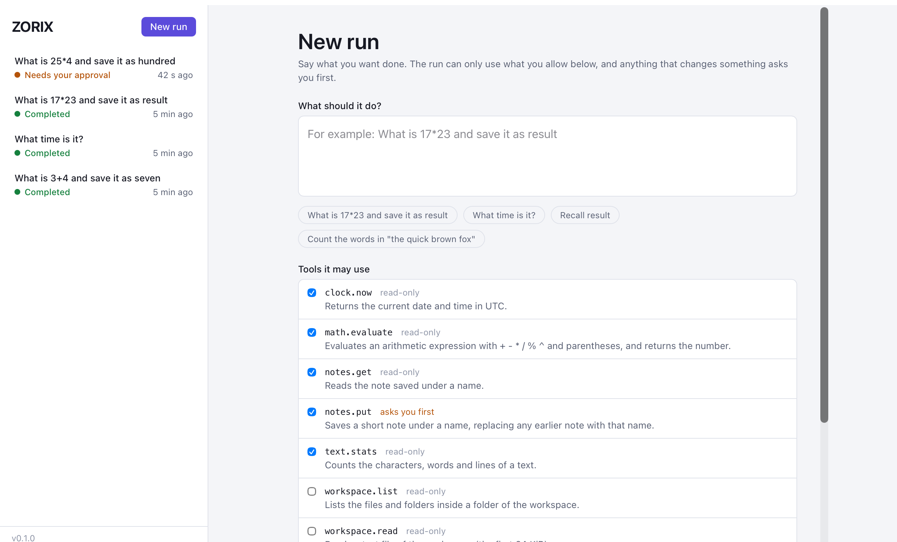

# The desktop app


The desktop app is a Tauri 2 shell around the same engine the command line uses. The interface (Svelte 5) decides
nothing: it asks the engine and shows what comes back. Permissions, approvals and state live in Rust.

## What is in this version

| Area | What you can do |
|---|---|
| **Runs list** | Every execution, newest first, with its state and age. Updates on its own |
| **New run** | Describe the activity, choose the tools it may use, optionally a workspace folder with read and write patterns |
| **Run view** | State, steps, tool calls, tokens and work time; the result or the failure; the timeline of events live |
| **Approval card** | The tool, the exact arguments, why you are asked, and a fingerprint of the call. Approve or refuse, with an optional note |
| **Controls** | Pause, resume and cancel |



Nothing is allowed by default. The form preselects the demo tools that need only a tool permission; the file tools start
off because they need a workspace. Tools that change things say **asks you first**.

The app uses the built-in **demo model**; real providers arrive in Phase 2. The full interface (agents, workflows,
dashboards, settings) belongs to later phases.

## Running it

```bash
cd apps/desktop
npm install
ZORIX_HOME=/some/throwaway/folder npm run tauri dev     # hot reload for the interface
```

Build an installer for your platform with `npm run tauri build`.

## Good to know

- **One program at a time.** The app locks the data folder, like the command line does. If the command line holds it, the
  app shows *"ZORIX could not start"* with the reason. Close the other program and start again.
- **Runs started elsewhere show up.** A run left waiting by `zorix run … --approve never` appears in the list, and you can
  approve it here. It continues from its checkpoint.
- **Closing the window is not cancelling.** Work stops at its last checkpoint. It continues the next time ZORIX starts
  (the app runs recovery at start-up). A call that was running and cannot safely be repeated asks you first.
- **Data stays on your computer.** The app makes no network connections of its own. It uses a strict content security
  policy and only the dialog permission (to choose the workspace folder).

## How it is built

```
Svelte (src/)  ──invoke / Channel──►  Tauri commands (src-tauri/src/commands.rs)  ──►  Engine (zorix-runtime)
```

- `src/lib/api.ts` is the only file that talks to Rust; its types mirror what the engine sends.
- `src/lib/stores/runs.svelte.ts` holds state as a rune-based class. Effects follow ids, not objects, because objects are
  replaced on every refresh.
- `src/lib/format.ts` turns states and events into words (pure, tested with `npm test`).
- Live events arrive through a Tauri `Channel`: first what is stored, then what happens, without gaps or repeats.
