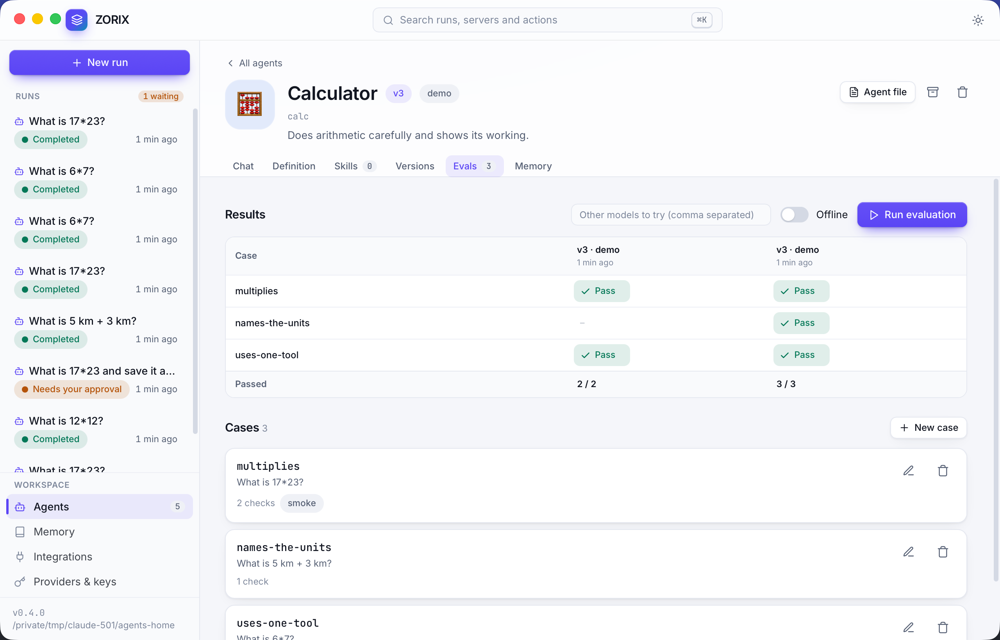

# Evaluations

An **evaluation** answers "did this change make the agent worse?". An agent has **cases**: something to ask and what the answer must
meet. A **run** tries every case on one version of the agent with one model, and keeps the results, so two runs can be compared case by
case. The design is in ADR [0028](adr/0028-evals.md).



## A case

```json
{
  "name": "cites-its-sources",
  "prompt": "What is the boiling point of water at sea level? Give a source.",
  "tags": ["smoke"],
  "checks": [
    {"kind": "regex", "pattern": "(?i)100\\s*°?\\s*c"},
    {"kind": "contains", "text": "Sources", "ignore_case": true},
    {"kind": "max_tool_calls", "calls": 8}
  ],
  "judge": {"rubric": "The answer is correct and names its source.", "model": "default", "pass_score": 4}
}
```

`zorix eval add AGENT cases.json` takes one case or a list (`-` reads standard input). The *Evals* tab has an editor.

| Check | Holds when |
|---|---|
| `contains`, `not_contains` (`ignore_case`) | The answer has, or lacks, the text |
| `regex` | The answer matches the expression |
| `json_schema` | The answer (structured, or the text read as JSON) satisfies the schema |
| `tool_used` (`pattern`, `min`), `tool_not_used` | A tool matching the pattern was (or was never) called; a prefix ends in `*` |
| `max_steps`, `max_tool_calls`, `max_cost_usd` | The run stayed within the limit |
| `status` | The run ended in this state (`completed` unless you say otherwise) |

A run that did not complete fails its case. Every failed check says why.

## The judge

A case may also have a **judge**: a model that reads your rubric and the answer and scores it from 1 to 5. The answer reaches the
judge as untrusted data and its reply must be strict JSON, so an answer cannot talk the judge into a pass; a reply that is not JSON
fails the case. The judge's cost is recorded. Deterministic checks are the base; use a judge for what rules cannot say.

## What a run of an evaluation may do

Evaluations run the **real agent**, so they are held back:

- `write` permissions are dropped unless the case sets `allow_writes`; `--offline` drops network access too.
- No conversation, no long-term memory and no agent memory. The executions carry the label `zorix.eval` and are **never recorded as past work**.
- An approval is **refused automatically** ("evaluations refuse approvals"), unless the case lists the tool in `approve` and it is not
  one that only a person may approve (`memory.remember` never is).
- At most two cases run at once, and a case has a time limit.

## Run and compare

```
zorix eval run researcher                       # newest version, its default model
zorix eval run researcher --version 2 --model anthropic/claude-opus-5-5 --model ollama/qwen3:8b --tag smoke
zorix eval runs researcher                      # past runs
zorix eval compare RUN_A RUN_B                  # FIXED / BROKE / same, with the change in steps, cost and score
```

`eval run` exits 1 when a case fails, and `compare` exits 1 when something broke, so both fit a script. In the app, the matrix shows
cases against the last five runs (each cell says Pass or Fail in words), a click opens the checks, the judge's reasons and the run, and
a line says how many cases the newest run fixed or broke compared with the one before.

## Making a good suite

Start small: three to five cases that would embarrass you if they failed, tagged `smoke`. Add a case when you find a mistake. Keep
checks about what matters (a fact, a format, a tool that must not be used), not exact wording, so a better answer does not fail.
Run the suite before and after you change instructions, skills or the model, and keep the run that was good.
