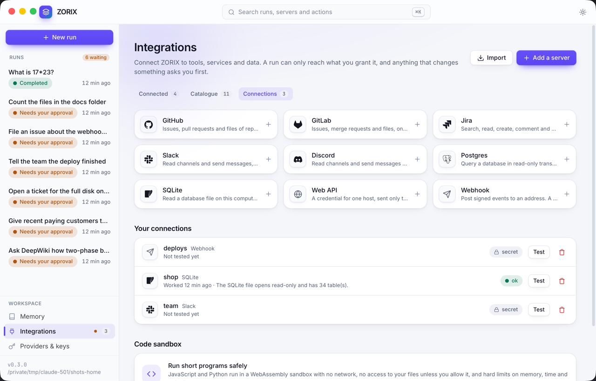

# Integrations

Besides MCP servers, ZORIX has **native integrations**: tools written for ZORIX, each behind grants on the resource it
touches, asking a person before it changes anything, with secrets chosen by ZORIX and never by the model. The design is in
ADR [0021](adr/0021-integrations-and-grants.md).

| Family | Tools | Grant |
|---|---|---|
| Web | `http.get`, `http.request`, `webhook.send` | `network` on `http:<host>` |
| GitHub, GitLab | `github.*`, `gitlab.*`: issues, pull or merge requests, files, comments, search | `read` / `write` on `github:<owner>/<repo>` |
| Jira | `jira.*`: search, get, comments, transitions, create | `read` / `write` on `jira:<KEY>` |
| Slack, Discord | `slack.*`, `discord.*`: list channels, read, send | `read` / `write` on `slack:<channel>` |
| Databases | `db.schema`, `db.query`, `db.execute` (SQLite and Postgres) | `read` / `write` on `db:<connection>` |
| Code | `code.run`, `code.run_in_workspace` ([sandbox](sandbox.md)) | `execute` on `code:javascript` / `code:python` |

A tool needs `use_tool` on its id **and** the permission on the resource. The `--allow-…` flags (and the "Servers and services"
card of the New run form) give both:

| Flag | Meaning |
|---|---|
| `--allow-http HOST` | `http.get`, `http.request`, `webhook.send` to this host over HTTPS (a trailing `*` is allowed) |
| `--allow-repo [github:\|gitlab:]OWNER/REPO[:write]` | A repository, or `OWNER/*`. Without `:write`, read only |
| `--allow-jira KEY[:write]` | A Jira project |
| `--allow-chat slack:#channel[:write]` or `discord:<channel id>[:write]` | A channel. Sending needs `:write` and still asks |
| `--allow-db NAME[:write]` | A database connection. `db.execute` needs `:write` and always asks |
| `--allow-code javascript\|python` | Run code in the sandbox |

## Connections

A **connection** is a name, a kind, settings that are not secret, and optionally a secret in the keychain. Add them in
the app (Integrations › Connections) or with `zorix connect add github|gitlab|jira|slack|discord|postgres|sqlite|http|webhook
<name> …`; `zorix connect list`, `test <name>` and `remove <name>` do the rest. Secrets are read from a variable you name
(`--secret-env VAR`), standard input (`--secret-stdin`) or a hidden prompt, never from the arguments. **Test** makes one
harmless read (who am I, the rate limit, `SELECT version()`, opening the file) and says what it found; a webhook is never
sent to by a test.

## What each family does and guards

**Web (`http.*`).** HTTPS only (plain HTTP only to this computer). Every address is resolved, **every** resulting IP is checked,
and the connection goes to the IP that was checked, so DNS rebinding does not help; loopback, private and link-local addresses
(including `169.254.169.254`) are refused unless the exact host is granted. Redirects are followed manually, at most 5, and each
hop is checked and must be granted. No proxy is used. The model cannot send `Authorization`, cookies or similar headers; when a
connection exists for the host, ZORIX adds its credential, only over HTTPS and only to that host. GET and HEAD may run
without asking; everything else asks. Limits: 30 s, 2 MB of response, 1 MB of request, 20 headers.
`webhook.send` posts to the address of a *webhook connection*, signed: `X-Zorix-Signature` is `sha256=` and the HMAC-SHA256 of
`<timestamp>.<body>`, with the timestamp in `X-Zorix-Timestamp` and the event name in `X-Zorix-Event`, so a receiver can
recompute it and reject old messages; a person approves every send.

**GitHub and GitLab.** Reads work without a token on public data; writes (create or update an issue, comment) need a token
in a connection, a `:write` grant, and your approval, which shows the target and the text. Pagination is bounded per call.

**Jira.** Search runs JQL that is **always ANDed with the project you granted**, so a query cannot escape it. Writes ask.

**Slack and Discord.** Reading needs a read grant on the channel; sending needs a write grant and always asks. Slack refuses
`@channel`, `@here` and `@everyone`; Discord messages are sent with `allowed_mentions` empty, so nothing is pinged.

**Databases.** SQLite opens read-only with an authorizer, so even `ATTACH` or `PRAGMA` writes fail. Postgres uses
verified TLS by default (`verify-full`; `sslmode disable` is accepted only for a database on this computer, and a server
that does not offer TLS is refused rather than used unencrypted), and every `db.query` runs in a `READ ONLY`
transaction, so a data-modifying CTE or `set_config` cannot write. `db.execute` runs one statement in one transaction, shows
highlighted SQL on the approval card, and always asks. Limits: 1,000 rows, 5 MB, 15 s per statement, one statement per call.

## Other limits

Every API call: 30 s and 2 MB per response; a tool's result is cut to its output cap and marked. Names of connections are
1 to 32 lowercase letters, digits, `-` and `_`; at most 100 per tenant.

## Not in this version

Inbound webhooks and triggers (they belong to workflows, Phase 7), CIMD client registration, OAuth for the native
integrations (they use tokens), and sandboxing of stdio MCP servers. The Postgres path is exercised by CI against a real
server (the Linux job), not by the local test run.
