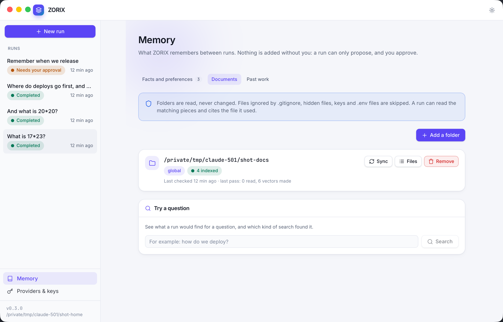
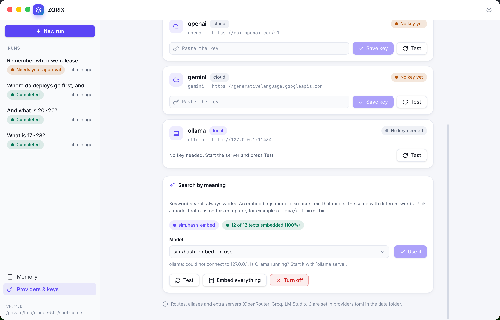

# Documents (knowledge)

Point ZORIX at a folder and runs can find, read and **cite** what is in it. The folder is only ever read.

```bash
zorix knowledge add ~/notes                       # for every run (the default)
zorix knowledge add ./docs --project .            # only for runs whose workspace is this project
zorix knowledge add ~/wiki --include '*.log' --exclude 'drafts/*' --auto-sync
zorix knowledge list
zorix knowledge sync [<folder>]                   # progress is shown; Ctrl-C stops, finished files stay indexed
zorix knowledge files <folder> --failed          # what was left out, and why
zorix knowledge search "how do we deploy"
zorix knowledge remove <folder>                   # removes the index; the files are not touched
```

In the desktop it is **Memory › Documents**: a card per folder with progress, **Sync**, **Stop**, the files that failed and why,
and a *try a question* panel that shows which search found each hit.



## What is read

| Kind | Files | Cut into pieces |
|---|---|---|
| Markdown | `.md`, `.markdown`, `.mdx` | By heading, keeping the heading path |
| Text | `.txt`, `.rst`, `.adoc`, `.org`, and files named README, CHANGELOG, LICENSE… | By size (about 3,200 characters) |
| Code and data | Common source files (Rust, Python, JavaScript, TypeScript, Go, Java…) and config and data files (JSON, YAML, TOML, CSV…) | Windows of 120 lines with 10 lines of overlap, keeping line numbers |
| HTML | `.html`, `.htm` | Text only, then by size |
| PDF | `.pdf` with a text layer | By page |
| Scanned PDF | `.pdf` that is pictures of pages, when [reading scans](#reading-scans) is on | By page, read by OCR on this computer |

An `--include` pattern adds other extensions (`*.log`), read as text. **Not** read: files ignored by `.gitignore`, `.ignore` or `.zorixignore`; hidden files and folders; links; binaries; and anything
that looks private (`.env*`, `*.pem`, `*.key`, `id_*`, `*.p12`, `.npmrc`, `.netrc`, `credentials*`, `secrets.*`). Text that looks
like a secret is removed from a piece before it is stored. A scanned PDF is left out with the reason *it is a scan, with no text to read* until [reading scans](#reading-scans) is turned on.

PDFs are parsed on a thread of their own with a time limit (30 seconds), a size limit (25 MB) and a page limit (500). A damaged or
hostile file is reported with its reason and never stops the sync.

## Reading scans

A PDF whose pages are pictures has no text to read. With **Reading scans** on (Documents › Reading scans, or `zorix settings set knowledge.ocr on`) ZORIX reads the text out of the pictures
on this computer ([ADR-0048](adr/0048-watching-folders-and-reading-scans.md)). It is off by default and needs two small models (about 12 MB), which are downloaded once into
`<home>/models/ocr/` and checked against fixed hashes; nothing leaves the computer except that one download. Turning the switch on reads the scans that were left out, and a folder shows
*N via OCR* and *N scans not read*; *Files* says why for each one that was not.

| | |
|---|---|
| What is read | The largest picture on each page of a PDF that has no text layer: JPEG, or raw grey, RGB or one-bit samples packed with Flate |
| What is not | JBIG2, CCITT, JPEG 2000, CMYK pictures, stencil masks: left out with the name of what was found |
| Limits | 100 pages, 40 million pixels in a picture, 60,000 characters a page, 300 seconds a file |
| Speed | About a second for a full page at 150 dpi, about four at 300 dpi |
| Language | Latin script (English and the languages that use it). Other scripts come out wrong, not empty |
| Retried | A scan that failed is read again only when its file changes; one that was left out for lack of a reader, when the switch is turned on |

The models can be put in `<home>/models/ocr/` by hand (`text-detection.onnx` and `text-recognition.onnx`) on a computer that cannot download them: they are used only when they are the exact files
ZORIX expects. Turning the switch off unloads the engine and keeps the files, and what was read stays in the index.

## Keeping it up to date

A folder that is **watched** is read again by itself a few seconds after its files stop changing: the system says when something changed, the app waits two seconds of quiet, and runs one sync
([ADR-0048](adr/0048-watching-folders-and-reading-scans.md)). New folders are watched; mark an older one with the *Watch* button, or `zorix knowledge add --watch`. A folder the system cannot watch (a network drive) is checked every ten minutes, and the screen says why.
`zorix knowledge watch` does the same in a terminal. **Sync** looks at every file: unchanged size and time means skip; otherwise the file is read and its SHA-256 hash decides
whether it is cut again: a file that was only touched keeps its pieces (and costs one read), and only a file whose content changed is re-cut and re-embedded. Files that disappeared are removed. With *check at
start* (`--auto-sync`) the desktop does that pass when it opens. A sync is cancellable, and can be repeated: it continues where it
stopped.

## What a run gets

The best pieces for the task, at most 3 per file, neighbours merged, within 8,000 tokens. Each is wrapped as untrusted data with
its source (`guide/deploy.md:L10-L42`, or `manual.pdf:p3`), so the answer can name the file. Runs can also ask for more with the
`knowledge.search` tool. See [memory](memory.md#untrusted-data).

A file does not have to be indexed to be read by one run: **attach** it (the button, `@` or dropping it in New run, or `zorix run --attach FILE`) and that run is given its text as data
([ADR-0049](adr/0049-files-attached-to-a-run.md)). Indexing is for what many runs should find; attaching is for what this run should read.

## Search by meaning

Keyword search always works. An **embeddings model** adds search by meaning (*"how do releases reach production"* finds *"deploys
go to staging first"*). One model per installation:

```bash
ollama pull all-minilm                         # 23 MB, runs on this computer
zorix embeddings models                        # what is on offer
zorix embeddings set ollama/all-minilm
zorix embeddings reembed                       # vectors for everything already indexed
zorix embeddings show                          # model, dimensions, how much is embedded
zorix embeddings test
zorix embeddings off                           # keywords only again
```

Providers: **Ollama** (`/api/embed`), **OpenAI** and compatible servers (`/v1/embeddings`), **Gemini** (`batchEmbedContents`).
Anthropic has no embeddings. A vector is kept by *model and text*, so unchanged text is never embedded twice and changing the model
only embeds what is missing.



> **A cloud embeddings model receives your text**: the pieces of your documents, your facts and every question a run asks. For that
> reason `embeddings set` refuses a cloud provider unless you add `--cloud` (a checkbox in the desktop), and `--local-only` runs
> never use one. Embeddings never fall back to another model: a different model makes different vectors.

If the model is unavailable when a run starts, the run goes on with keyword search and its context says why.

## Limits

| What | Limit |
|---|---|
| Folders per installation | 50 |
| Files looked at per folder | 20,000 |
| A text file | 2 MB |
| A PDF | 25 MB, 500 pages, 30 seconds |
| Pieces per file | 2,000 |
| Pieces per installation | 500,000 (search by meaning uses an [index](adr/0047-index-of-document-vectors.md) above 20,000 visible pieces) |

## Good to know

- The data folder is locked by one program at a time, so `zorix knowledge sync` fails while the desktop app is open.
- Moving or renaming an indexed folder: remove it and add it again.
- Deleting a folder from the index deletes its pieces, search entries and vectors, and scrubs them from the saved context of past runs. So does
  indexing a changed file again: its old pieces leave the saved context of past runs, so no old version of a file outlives its folder.
