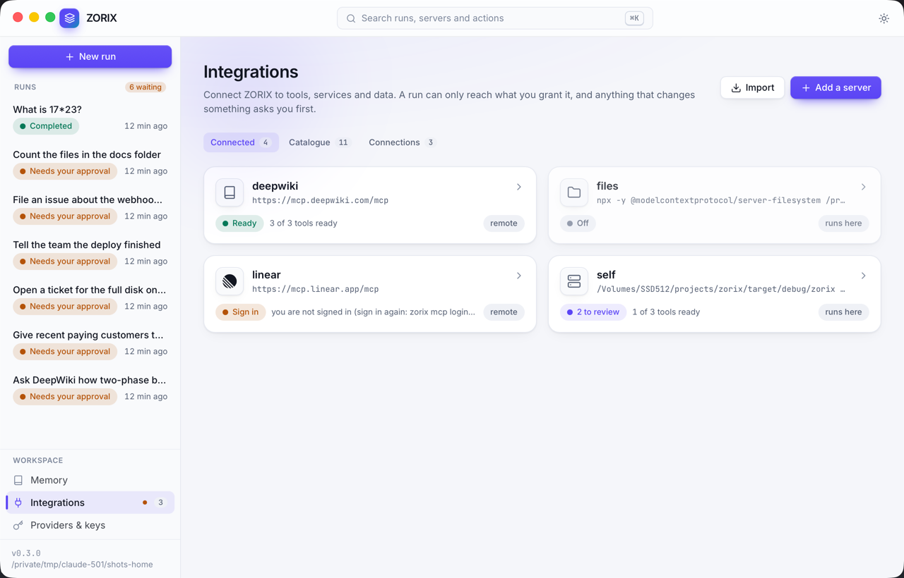

# MCP servers

ZORIX is an MCP client: it can use the tools of any [Model Context Protocol](https://modelcontextprotocol.io) server, and
it is an MCP server too, so other programs can use its memory. This page explains what a person can do, how ZORIX keeps
that safe, and what it does not do. The design is in ADR [0018](adr/0018-mcp-client-and-trust.md),
[0019](adr/0019-oauth-and-tokens.md), [0020](adr/0020-dynamic-registry-and-run-snapshot.md) and
[0023](adr/0023-zorix-as-mcp-server.md).



## Using a server

1. **Add it.** From the catalogue (`zorix mcp add --catalog github`, or the Catalogue tab), from a command
   (`zorix mcp add tools --command npx --arg -y --arg some-server`), from an address
   (`zorix mcp add docs --url https://mcp.example.com/mcp --auth oauth`), or by importing what you already set up in Claude
   Desktop, VS Code or Cursor (`zorix mcp import --from claude`, shown first, imported only with `--yes`).
2. **Turn it on.** A new server is **off**. Turning it on shows what it will run and asks you to confirm; a program started
   this way can do anything you can do.
3. **Review its tools.** ZORIX starts the server, reads its tools and shows each description. A tool is not offered to
   any run until you approve it (`zorix mcp review <name>`, or the drawer on the Integrations screen).
4. **Grant it to a run.** `--allow 'mcp.<server>.*'` on the command line, or the server's chip in the New run form. A run
   sees only the servers it was granted.

Tool ids are `mcp.<server>.<tool>`; the server name is the one you chose.

## What ZORIX does to keep it safe

- **Every MCP tool asks first.** The tool's own hints (`readOnlyHint` and so on) describe, they never grant. For a tool the
  server reports as read-only, not destructive, and **says in so many words that it stays inside the server**
  (`readOnlyHint: true` and `openWorldHint: false`; the specification's default for a tool that says nothing is that it reaches
  outside) a person may choose *Don't ask before using it* (`zorix mcp trust <name> --tool <tool> --read-only-without-asking`);
  the call still shows in the run. A choice made earlier for a tool that does not say so is taken back the next time the server's
  tools are read.
- **Tool definitions are pinned.** The hash of a tool's name, description and schemas is stored when you approve it. If the
  server later lists something different (a "rug pull", or a description with instructions added) the tool is withdrawn, its
  trust goes back to *ask*, and the screen shows exactly what changed (`DiffView`, or `zorix mcp review`) until you decide.
  **An approval is for what you were shown**: the screen sends the hash of the definition on display with the click, and if the
  server changed the tool in between, nothing is approved and you are told to read it again (`Approve all` does the same for each
  tool, and leaves a changed one waiting). `zorix mcp review --approve TOOL` and `--approve-all` approve what the server lists at
  that moment, which is what those flags say.
- **A running execution keeps what it started with.** A run pins the tool definitions it was offered; a server changing a tool
  mid-run cannot change what that run sees or what it may call (ADR-0020).
- **Results are data.** What a server returns is labelled as the result of a tool and never followed as an instruction;
  size limits apply.
- **Servers are asked for nothing and answer little.** ZORIX answers `ping` and refuses everything else a server may ask of a
  client: sampling (spending your model tokens), elicitation, and roots. A server cannot read your workspace through ZORIX.
- **A stdio server is a program running as you.** There is no sandbox around it. ZORIX starts it without a shell, with a clean
  environment plus the variables you named (secrets from the keychain), in its own process group, and keeps the last 1 MB of
  what it wrote on its error stream, with secrets removed. The interface says all of this before you turn one on.
- **Secrets stay in the keychain.** Environment secrets and bearer tokens are stored by name in the system keychain;
  the database holds only that a secret exists.

## Both protocol eras

The 2026-07-28 revision removed the handshake: every request carries its own metadata and there is no session. Revisions up to
2025-11-25 begin with `initialize`. ZORIX speaks both. It asks `server/discover` first; a server that answers something else
(an error, nothing within 8 seconds) is treated as an older one and gets `initialize`. The era found is remembered per
server (`modern` or `legacy`). Transports are stdio and Streamable HTTP (the old HTTP+SSE of 2024-11-05 is not supported).
Changes to a server's tool list reach ZORIX live over `subscriptions/listen` on modern servers, and at start or *Refresh
tools* on older HTTP servers.

## Signing in (OAuth)

Remote servers may need a sign-in. ZORIX follows OAuth 2.1 as MCP specifies it: it reads the server's protected-resource
metadata (RFC 9728) and the authorization server's (RFC 8414 or OpenID), registers itself as a public client (RFC 7591) when
the server allows, and uses PKCE with S256, a state value, and the `resource` indicator (RFC 8707). The browser opens
the system's default; the redirect goes to `127.0.0.1` on a random port. The issuer is checked against what it was before the
browser opened (RFC 9207). Tokens (a refresh token and a short-lived access token) live in two keychain entries per server,
are refreshed before they expire, and are sent only to the server they were issued for. If a refresh fails the server shows
*Sign in*. Use `--client-id` for servers that need a client registered in advance (Slack and GitHub, for example; the catalogue
uses a personal access token for GitHub). Client ID metadata documents are not implemented.

**Where a sign-in may reach.** The addresses used to sign in (the metadata address in the server's challenge, the authorization
server, its registration, token and revocation endpoints) are named by the *server*. A server on the internet may not name an
address on your own network: this computer's services, the cloud metadata address or a private network. Every name is resolved
by ZORIX, every answer is checked and the connection goes to the address that was checked, so a name that answers with a
private address is refused as well. A server that is itself on a private network (a company's own host, or a server on this
computer) may name private addresses. A sign-in goes straight out, not through a proxy, unless the environment names one
(`HTTPS_PROXY`, `ALL_PROXY`); then the name is still checked, but the connection is the proxy's. The browser's answer ends the
wait only when it carries this sign-in's `state`: another program knocking on the port is turned away.

## Limits

| Limit | Value |
|---|---|
| Servers per tenant | 50 |
| Tools per server | 200 (more is an error, not a silent cut) |
| Tool name | 1 to 128 characters: letters, digits, `_`, `-`, `.` |
| A message | 4 MB (a server that writes more is cut off) |
| A call | 60 seconds, cancellable; the server is told |
| Waiting for a server's handshake | 30 seconds; the legacy probe waits 8 |
| Restarts after a crash | after 1, 2, 4, 8 and 16 seconds, then it gives up and says why |
| Error stream kept | 1 MB, secrets removed |

## ZORIX as an MCP server

```text
zorix mcp serve                       # read-only: memory.search, knowledge.search, history.search
zorix mcp serve --project ~/code/app  # whose memories and documents are visible
zorix mcp serve --allow-runs --allow math.evaluate --model anthropic/claude-opus-5-5
```

It speaks MCP on standard input and output, in both eras, and writes nothing else to standard output (logs go to standard
error). By default it is **read-only** and takes no lock on the data folder, so it works while the desktop app is open:
an outside agent can *read* what you told ZORIX to remember, never change it. `--allow-runs` adds `zorix.run`,
`zorix.status` and `zorix.result`; it takes the data-folder lock for as long as it runs, runs use the tools, files and limits
the flags give them, and a run that needs an approval waits for it **in ZORIX**: no MCP client can approve a call. In Claude
Code, for example: `claude mcp add zorix -- zorix mcp serve`.

**Agents.** `zorix.agents` is always there: it lists the agents you made (name, description, default model, version and the names of
their skills; never their instructions). With `--allow-runs`, **`zorix.run_agent`** `{agent, prompt, input?, model?, wait_seconds?}` runs one and
answers like `zorix.run`, plus the agent and version that answered. A client's run gets only what you allowed when you started the server,
whatever the agent can do in ZORIX: `--allow TOOL`, `--allow-read`, `--allow-write` and `--allow-access ENTRY` (an access entry such as
`http:api.example.com`, `repo:acme/api`, `db:reports` or `code:python`) are **intersected** with the agent's own tools and access. With no
`--allow` flags a client gets an agent with nothing to use, which is safe and usually not what you want: add what the agents need, for
example `--allow 'skill.*' --allow-access code:python`. `zorix.status` and `zorix.result` follow either kind of run, but only a run **this server started** (and the sub-runs below it): other runs of the data folder hold what you asked in ZORIX and its answers, and a client is not you. `--allow-read-runs` lets a client follow any run of the folder. A run that is not the client's gets the same refusal as one that does not exist, so a client cannot tell which ids are in use.

**Teams.** `zorix.agents` also lists the teams (name, description, lead, members), and `zorix.run_agent` takes `team`: the run is the lead's, and the lead may ask the members
([teams](teams.md)). The same `--allow` flags apply to the lead and, intersected, to every sub-run. `zorix.status` reports `sub_runs` (state, agent, cost) so a client can show
progress; an approval asked by a sub-run still waits in ZORIX.

## Troubleshooting

- **"Sign in"** on a card, or `needs sign-in` in `zorix mcp tools`: `zorix mcp login <name>`.
- **A server stays *Starting* or *Failed*:** open its **Logs** tab (or `zorix mcp logs <name>`); `npx` servers need Node
  installed, and the first start may download the package.
- **A tool disappeared from runs:** its description changed. Review it.
- **"Tool … not found" in a run:** the server was not granted (`--allow 'mcp.<server>.*'`) or not running when the run
  started.
