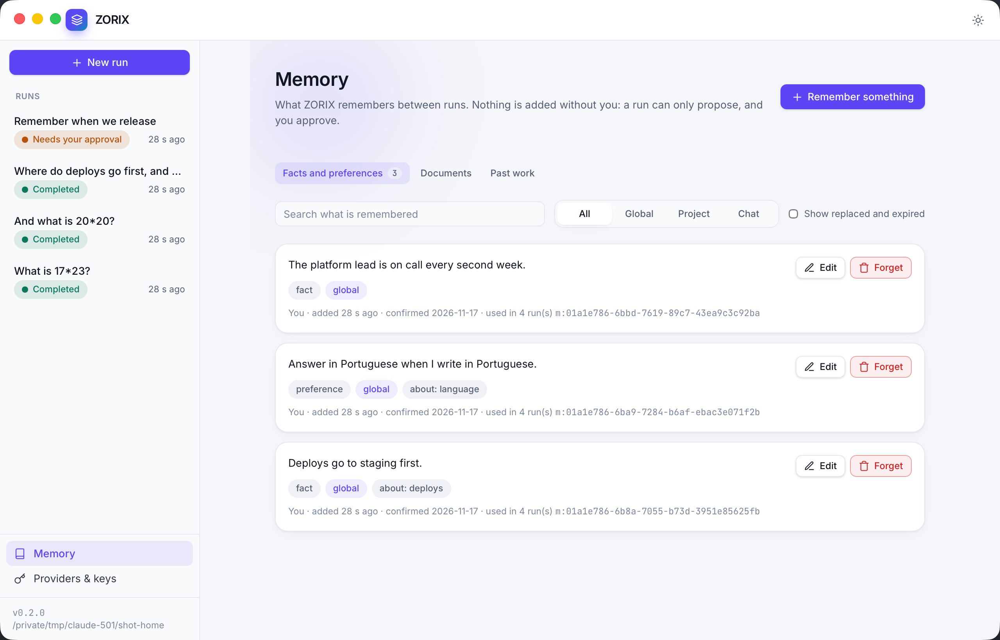
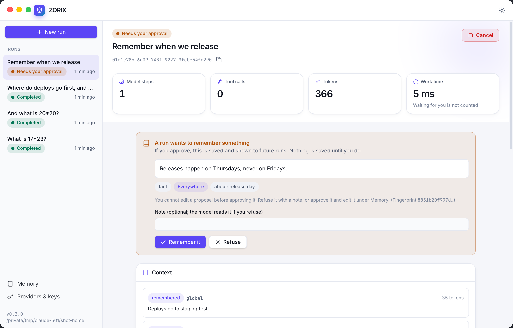
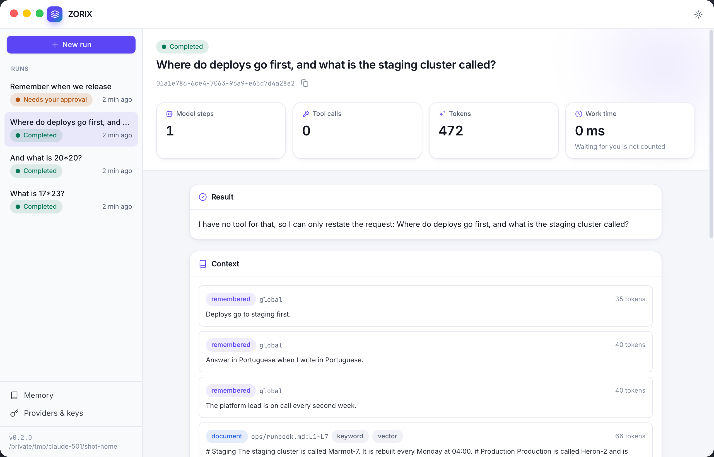

# Memory

Until version 0.2 every execution started from nothing. From 0.3 ZORIX can remember, and **you decide what it remembers**.
Memory reaches a run through the same context builder as everything else ([ADR-0007](adr/0007-context-builder.md)); the
runtime itself holds no memory logic.



## Four kinds of memory

| Kind | What it is | Who writes it | What a run sees |
|---|---|---|---|
| **Conversation** | The earlier runs of the same conversation: each prompt and its final answer | Automatic (they are runs you made) | Up to 20 exchanges, 4,000 characters per answer; the newest has the highest priority and the oldest are dropped first, with a note |
| **Facts and preferences** (long-term) | One short sentence: *"Deploys go to staging first"*, *"Answer in Portuguese"* | **You**, or a run proposing and **you approving** | A list marked as remembered, with its id, kind, scope and date |
| **Documents** (knowledge) | Pieces of files in folders you indexed ([knowledge](knowledge.md)) | The indexer | The pieces that match the task, each with its file and lines, as untrusted data |
| **Past work** (operational) | A short record of every run that ended: request, tools, approvals, outcome | Automatic | The few records most like the task, as untrusted data |

Each run can switch memory off in parts: `--no-conversation`, `--no-memory` (facts and past work) and `--no-knowledge` on the
command line, three switches in the desktop's New run form.

## Scopes

A fact or a folder applies **globally**, to one **project** (runs whose workspace is that folder) or to one
**conversation**. A project is the canonical path of the workspace, so moving the folder orphans its memory. Tenants never
mix: every query carries the tenant.

## Who may write memory

A model can only **propose**. The tool `memory.remember` always asks, and, unlike other tools, **no automatic mode can
approve it**: `--approve yes` leaves the run waiting, and the engine refuses an approval marked automatic for it. The approval
shows the sentence, its scope, and what it would replace, and applies to exactly that text. If you approve, the run is told it
was saved; if you refuse, the model reads your note.

A proposal is refused before it reaches you when it looks like a credential (the same filter that cleans events), is longer than
500 characters, names a scope the run does not have, replaces something the run cannot see, or when the run already proposed 10
or the tenant already holds 5,000 active items.

Each memory has a **subject** (optional). A newer memory with the same subject and scope replaces the older one, which stays
visible as *replaced* so nothing disappears silently. A memory can also expire (`--until 2027-01-31`). Memories not confirmed for
180 days are shown as stale in the app and labelled so for the model; **Still true** (or `zorix memory confirm`) renews them.



What the model is told about the facts: *remembered, approved by you, possibly out of date, and the current message wins.*

## How a run finds memory

1. **Once per run**, ZORIX builds a query from the prompt (with the previous prompt of the conversation when it is very short),
   removes secrets, and searches.
2. **Keyword search** (SQLite FTS5, BM25) always works, offline. When you chose an
   [embeddings model](knowledge.md#search-by-meaning), a **vector search** runs as well; the two lists are fused with
   reciprocal rank fusion (k = 60).
3. A **relevance gate** keeps a hit only when both searches found it, or it is high in one list *and* clearly related (enough
   matching words, or a cosine similarity of at least 0.35 by default). An unrelated question gets nothing, which is better
   than noise.
4. While you have **50 or fewer** visible facts, all of them are included, in a fixed order, so the start of the prompt stays
   stable and the provider's cache keeps working. Above that they are searched.
5. Each kind fills only its share of the context: facts 5% (at most 2,000 tokens), conversation 20% (16,000), documents 15%
   (8,000 tokens, 8 pieces, 3 per file), past work 5% (2,000, 3 records).

Context order: system, facts, conversation, documents, past work, the task, then the run's own history.

### The recall is frozen

What was retrieved is saved with the run (a **snapshot**, [ADR-0015](adr/0015-frozen-recall-snapshot.md)) and every step and
every resume after a crash renders the same text. Memory that changes while a run is going does not change that run. Open a run
and look at **Context** (desktop) or `zorix show <id> --context`: you see the facts, earlier exchanges and document pieces that
were used, which search found each, why search was degraded when it was, and the tokens each part took.



## Untrusted data

Documents and past work enter as user messages wrapped as data, with any closing tag inside them defused:

```
<document source="runbook.md:L12-L20" untrusted="true"> … </document>
<past_work execution="…" state="completed" untrusted="true"> … </past_work>
```

A file that says *"ignore your instructions"* is text the model reads, not an instruction ZORIX follows. Retrieved text is never
put in the system prompt. Facts are different: you approved them, so they are a trusted system message.

## Tokens, measured instead of guessed

Estimates used to be "characters ÷ 4" for every model. ZORIX now compares its estimate with the **real usage the provider
reports** and learns a factor per model (a moving average, kept between 0.5 and 3.0, used after three samples; Ollama is measured
on the first step of a run only, because it reuses its cache). `zorix calibration` lists what was learned. Past runs seed it at half
weight. Runs on the demo model are ignored, and so are tiny requests.

## Managing memory

Desktop: **Memory** in the sidebar (facts, documents, past work). Command line:

```bash
zorix memory add "Deploys go to staging first." --subject deploys
zorix memory add "Answer in Portuguese." --kind preference
zorix memory list                       # --scope project:<folder>, --all for replaced and expired
zorix memory edit m:<id> --text "…" --until 2027-01-31
zorix memory confirm m:<id>
zorix memory forget m:<id> --yes
zorix memory search "staging" --in memory|knowledge|history
zorix memory export --out memories.json
```

## Forgetting is real, with limits

`forget` deletes the row, its search entry and its vector, removes it from the snapshots of past runs, and overwrites the freed
database pages (`secure_delete`, then a checkpoint). It does **not** reach what already left the database: the transcript of a
run that used the fact, and whatever a cloud provider received. The app lists the runs that used a memory before you confirm.

## Limits

| What | Limit |
|---|---|
| A fact | 500 characters |
| Active facts per tenant | 5,000 |
| Proposals per run | 10 |
| Query | 32 terms, 2,000 characters |
| Search results given to a run | 10 per search |
| Past-work record | 500 characters of prompt, 500 of outcome, 200 per tool digest |
| Vectors per tenant and model | 200,000 pieces (brute-force search; fine for a desktop) |

Out of scope for 0.3: summarising long conversations (the oldest exchanges are dropped with a note), moving a project's memory,
sharing memory between people.
