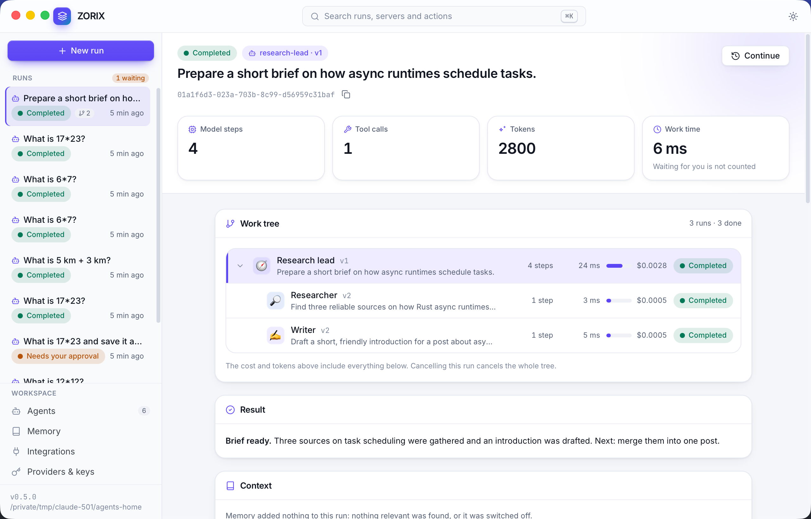
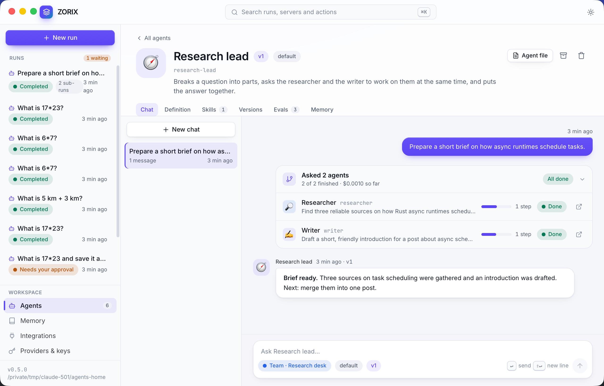

# Orchestration

An [agent](agents.md) can hand part of its work to other agents. A run that does this is the **parent**; the runs it starts are
its **children** (sub-runs); together they are a **tree**. Nothing here is a new kind of run: a child is an ordinary
[execution](runtime.md) with its own steps, tools, approvals, events and result. What orchestration adds is a way to ask, a way to
wait without holding a worker, and rules that keep a tree inside what the person allowed. The design is in ADRs
[0029](adr/0029-delegation-and-waiting-for-children.md), [0030](adr/0030-budgets-permissions-and-approvals-down-the-tree.md)
and [0031](adr/0031-teams-and-the-handoff-format.md); the survey that led to it is
[research/orchestration-landscape.md](research/orchestration-landscape.md).



## Asking: the `agents.delegate` tool

A parent delegates with one tool call. The model decides when; the person decides who may be asked, with an `agent:` entry in
the agent's access (`agent:researcher`, or `agent:*`) or by running a [team](teams.md).

```json
{"tasks": [
  {"agent": "researcher", "task": "Find three sources on how async runtimes schedule tasks.",
   "expected_output": {"type": "object", "properties": {"sources": {"type": "array"}}},
   "context": ["The post is for beginners."], "files": ["docs/*.md"]},
  {"agent": "writer", "task": "Draft a friendly introduction."}
]}
```

| Field | Meaning |
|---|---|
| `agent` | The agent to ask (its slug). Required |
| `task` | What to do, in words. Required |
| `input` | Structured input for the task (any JSON) |
| `expected_output` | A JSON Schema the child's answer must satisfy. The child runs with it as its output schema, so a wrong shape is rejected and retried like any answer, and `structured` carries the parsed result |
| `context` | Short notes the child should know. They are part of its task, not of a conversation |
| `files` | Workspace patterns the child may read. They can only narrow what the parent can read |

A call takes **1 to 8** tasks and runs them **at the same time** (fan-out). The parent then waits for all of them (fan-in).

## Waiting without holding a worker

A parent that waits for its children does not keep a worker. The engine has a fixed number of workers; if a parent held one
while its child needed one, a few nested parents would use them all and nothing would move. Instead:

1. The runtime checks the call like any other (grants, arguments, approval), then asks the planner to turn each task into a run.
2. It creates the children with a key made from the parent, the call and the position (`delegate:{parent}:{call}:{i}`), so a
   restart never makes the same child twice.
3. It marks the call `delegated`, writes a checkpoint and moves the parent to **`waiting_for_children`**. Only then are the children
   started, and the parent's worker is released.
4. When every child has finished, the engine writes their results into the call, adds their usage to the parent's, and queues the
   parent. It resumes from the call: the model sees the results as the answer of `agents.delegate`.

What the parent receives, one entry per task:

```json
{"results": [{"agent": "researcher", "version": 2, "task": "…", "state": "completed", "answer": "…",
              "structured": null, "steps": 3, "tool_calls": 2, "cost_micros": 5120, "child_id": "…"}]}
```

A child that **failed or was cancelled is reported, not raised**: the parent's model reads `state` and `error` and decides what to do
(ask again, ask someone else, answer with what it has).

If ZORIX stops while a parent waits, recovery looks at its children: if all of them are finished it settles the parent; if not, it
leaves the parent waiting while each child recovers on its own.

## What only gets smaller down the tree

A child can never do more than the run that asked it ([ADR-0030](adr/0030-budgets-permissions-and-approvals-down-the-tree.md)).

| What | Rule |
|---|---|
| Permissions | The child's grants are its own agent's grants **intersected** with the parent's. An agent that is allowed to use `http:example.org` on its own still cannot use it for a parent that cannot |
| Who may be asked | The parent's `agent:` entries (or its team's members). Asking an agent that is already above in the chain (a loop), an archived agent, or one the parent may not ask is refused with a reason the model sees |
| Models | The child keeps its own allow-list, and every model it could be routed to must also be allowed by the parent |
| Budget | The parent's **remaining** cost, tokens and tool calls are split equally among the children of one call (at least 1 each). Iterations and active time are the smaller of the child agent's and the parent's |
| Roll-up | When children finish, their cost, tokens, model calls and tool calls are added to the parent. A limit that is passed stops the parent at its next step |
| Memory | A child's memory switches are narrowed by the parent's. A child has no conversation |
| Evals | A run made for an evaluation passes that on to its children |

| Guard | Limit |
|---|---|
| Depth | 3 levels below the root |
| Tasks in one call | 8 |
| Runs below one root | 32 |

## Approvals rise to the root

A sub-run that needs a person (a write, a connection, a memory) stops, and **so does the root**: the tree is waiting for you. You do
not have to find the sub-run.

- In the **command line**, `zorix run` shows the request with the agent that asked and answers it in the same terminal when
  `--approve ask` is used. Otherwise it exits with code 3 and `zorix approve ROOT` or `zorix deny ROOT` answers the one that waits.
- In the **app**, the run view shows a **Waiting in the tree** card for each approval below, and the agent's chat shows it inside the
  delegation card, next to the sub-run that asked. The answer is recorded on the sub-run, bound to the call it names, like any other.

## Stopping

Cancelling the root cancels every run below it, from the top down, and the children's records say so. Cancelling a child on its own
only cancels that run; the parent receives `state: "cancelled"` for it and carries on.

## Seeing a tree

- `zorix tree RUN` prints the tree from the top (any run in it will do), with state, steps and cost. `zorix show` lists the sub-runs and
  the run each one belongs to, and `zorix list` shows root runs only (`--all` shows everything, with `↳` before a sub-run).
- The run view has a **Work tree** card with state, steps, time and a share of the cost for each run; click a run to open it.
- The chat shows each delegate call as a card: who was asked, what each is doing right now, and each answer.



## Events

A tree adds three events to the parent's history: `execution.waiting_children`, `execution.child.started` and
`execution.child.settled` ([events](events.md)). Each child has its own full history; `zorix run --follow` merges them, marking the
lines of a sub-run with `↳` and its agent.

## What it does not do

- Children do not talk to each other, and do not share a scratchpad. Anything one needs from another goes through the parent.
- Splitting the budget is equal. If one task is far heavier than the others, give it its own call.
- Plain runs (no agent, no team) cannot delegate: the index of whom to ask is part of an agent's instructions.
