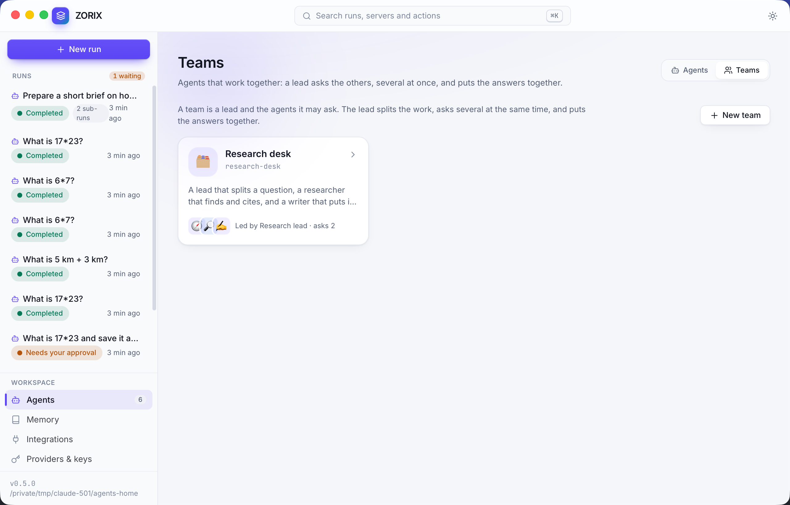
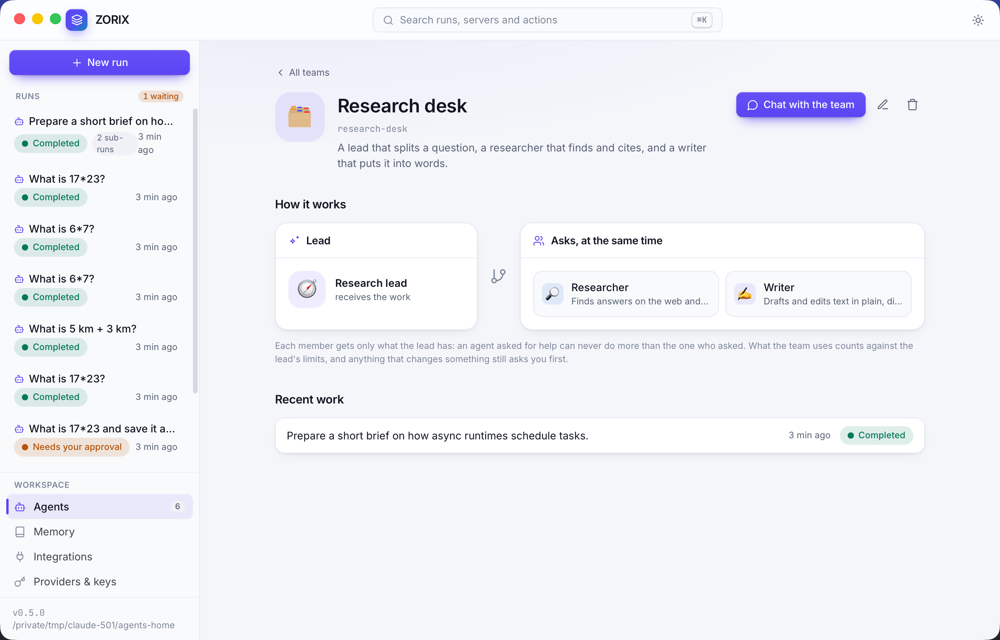

# Teams

A **team** is a lead and the agents it may ask. It is a convenient way to say "this agent leads, these may be asked" once, to run it
from one place, and to see it as a unit. It is a plain record, not a new kind of agent: running a team runs its lead, with permission to
ask the members. How asking works is in [orchestration](orchestration.md).



## What a team is made of

| Part | Meaning |
|---|---|
| `slug` | Its short name (lowercase letters, digits and dashes, up to 48) |
| `name`, `description`, `avatar` | What people see |
| `lead` | The agent that receives the work. It is **not** also a member |
| `members` | The agents the lead may ask (up to 12). They must exist |

There are no versions: change a team and it is changed. Every run still records the **version of every agent** in it, so a result can
be traced. Deleting a team leaves its agents alone; deleting an agent that a team lists leaves a hole that the team page and
`zorix team show` report, and a run on that team is refused until it is fixed.

## Running a team

- **Command line**: `zorix run --team research-desk "…"` (not together with `--agent`). The lead's run is marked *team research-desk*.
- **App**: *Chat with the team* on the team page opens the lead's chat in team mode; *New run* has the teams under **Run as**.
- **MCP**: `zorix.run_agent` takes `team` ([mcp](mcp.md)).

What changes for the lead: it gets permission to ask each member (`execute agent:MEMBER` and `use_tool agents.delegate`, narrowed like any
grant by the lead's own), and its instructions end with an `<available_agents>` index, one line per agent it may ask: name, slug and
description. Descriptions are the only thing a model reads to choose, so write them for that.



## The ready-made team

`zorix team add --template research-desk` (or *Add from templates* in the app) installs the **research desk**: the lead
`research-lead`, and `researcher` and `writer` as members. It adds only the agents that are missing and **never overwrites** one you
already have. `research-lead` carries a skill, *delegating-well*, about splitting a question into independent parts, writing tasks a stranger
could do, and checking what comes back; three evaluation cases include one that must delegate (`delegated` check, see [evals](evals.md)).

The starter members use the app's default model like any other starter agent; set one with `--model provider/model` or an alias before
the first run.

## From the command line

```
zorix team list | show NAME | create NAME --lead AGENT [--member AGENT]… [--name N] [--description D]
zorix team edit NAME [--lead AGENT] [--add-member AGENT]… [--remove-member AGENT]… [--name N] [--description D]
zorix team remove NAME --yes | add --template NAME | templates
zorix run --team NAME [--model M] "…"
```
