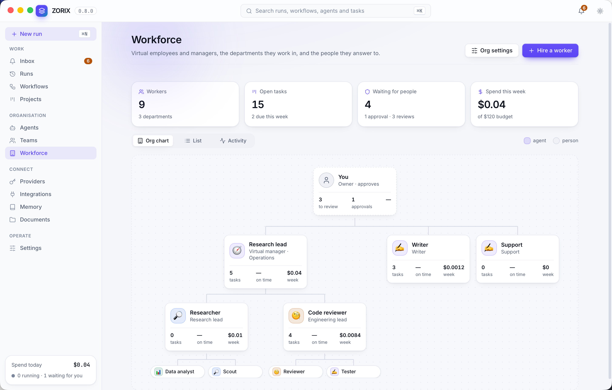
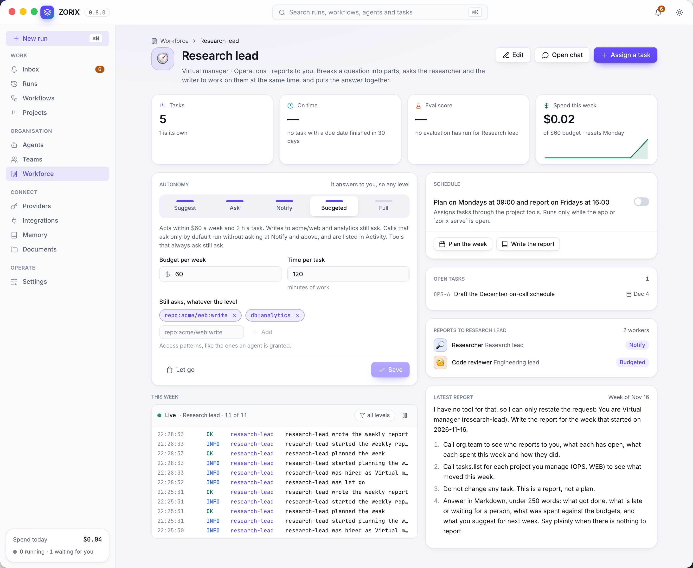

# Workforce

The workforce puts your agents in an organisation: each **worker** is an agent with a role, a department, someone to answer to, a level of **autonomy**, a weekly budget and a time for each task. A
**virtual manager** plans the week and writes the report on Fridays. The design is in [ADR-0038](adr/0038-workers-are-records-over-agents.md) and
[ADR-0039](adr/0039-autonomy-is-decided-by-the-policy.md).



## Workers and departments

- A worker is a record **over an existing agent**. Hiring does not change the agent: its tools, access and versions stay as they are, and removing the record changes nothing about the agent.
- Every chain of *reports to* ends at **you**. A worker cannot be freer than who it reports to, and its weekly budget cannot be larger than theirs (if the manager has a budget, the worker needs one).
  Lowering a manager below its reports is refused until the reports are lowered.
- A **department** groups workers for people to read, with an optional lead. Teams stay what they were: a lead and the colleagues it may ask.
- *Org settings* hold a weekly budget for everyone (empty means none), the level new workers start at (Ask) and the departments. A department with workers cannot be removed.

## Autonomy

Five levels, set for a worker, apply to the runs the **workforce starts**: a task's run, a manager's run and a scheduled one. A run you start yourself from *New run* is unchanged.

| Level | What it means |
|---|---|
| Suggest | Proposes; you act. A call that changes something does not run. It is recorded as a proposal with its exact arguments, and the model is told it was proposed |
| Ask | Every call that changes something asks, which is stricter than the default |
| Notify | A call that is held **only by the default policy** (a tool that can change data, or that asks without being person-only) runs without asking. It is recorded with the tool, the arguments and the level, and you are told |
| Budgeted | As Notify, within the weekly budget and the time for a task |
| Full | As Budgeted; reported in the weekly report |

What **never loosens at any level**: a tool only a person who is looking may approve (`tasks.move`, `memory.remember`), a call an explicit approval rule in the policy holds, and the access
patterns on the worker's own *still asks* list (such as `repo:acme/web:write`). A missing grant is still a denial. A delegated child runs at the level of the run that asked it.

**Limits.** Every run of a worker gets its time for a task. Its cost limit is the smaller of what was asked and what is left of the worker's weekly budget and of the organisation's. When either
week is spent, a new run **starts at Ask** and says why, so nothing changes without a person. A week starts on Monday, in the computer's time zone.

## What is measured

Figures are derived from projects, executions and evaluations, never stored: open **tasks**, the share done **on time** (tasks with a due date that went to Done in the last 30 days on or before it),
the latest finished **eval** score, spend **this week** and runs **waiting** for a person. A manager's figures include everyone who reports to it; a dash means there is nothing to measure yet.
Spend counts each cost once: a run's cost leaves out the runs it delegated, and evaluation runs are not counted.

## The manager's week

A worker marked as a manager can be asked to **plan the week** or **write the report**. Both start an ordinary run under its level and budget, with `org.team` (who reports to it, what each has open
and spent, how free each one is) and the projects it manages (`project:KEY:write` for the plan, read-only for the report). The answer is kept and sent to the Inbox. Every change the plan wants
still goes through `tasks.*`, so it asks or runs by the manager's level.

A manager has a **schedule**: plan on Mondays at 09:00 and report on Fridays at 16:00. It is **off** until you turn it on, runs only while the app or `zorix serve` is open, does not catch up the
slots that went by while it was off, and records a missed slot instead of running it late.

## The screens

The *Workforce* entry of the sidebar opens the org chart, a list and the activity of the workers, with the selected worker's panel; a worker has a page with its figures, its autonomy, its schedule,
its open tasks and its week. *Hire a worker* and *Org settings* are modals. The Inbox has a section for what the workers did that is worth a look (plans and reports, proposals, calls that ran
without asking at Notify, budget warnings); it does not count in the bell, because nothing waits for an answer.



## The command line

```
zorix org show | settings [--budget USD|none] [--level L] | activity [--limit N] | notices [--read]
zorix org dept add SLUG NAME [--description T] [--lead W] | edit SLUG [--name N] [--description T] [--lead W|none] | remove SLUG
zorix worker list | show W | fire W | level W LEVEL | schedule W on|off
zorix worker hire AGENT --role R --dept D [--reports-to W|you] [--manager] [--level L] [--budget USD] [--task-time MIN] [--still-ask ACCESS]…
zorix worker edit W [--role R] [--dept D] [--reports-to W|you] [--manager BOOL] [--level L] [--budget USD|none] [--task-time MIN] [--still-ask ACCESS|none]…
zorix worker plan W [PROMPT] | report W [PROMPT]        # start a run and follow it
```

Everything but `plan` and `report` needs no engine, so it works while the app is open. `--json` prints the same facts.

## Not here yet

People other than you and hiring them, a daily budget (Phase 10, with the Command Center), moving workers between departments by dragging, teams as workers and importing an org chart.
